# 01｜范式之变：GoF 的崩塌和分布式的血脉进化

> 《Agent 设计模式之美》第 01 讲 · 黄佳 · 核心命题：三代模式演进的根因是决策权从开发者搬到大模型，Agent 架构 = 不确定性之下的有界资源分配设计
> 原文链接：<https://time.geekbang.org/column/article/980729>
> 📝 相关笔记：[速览版](01-范式之变-速览版.md) · 💬 [思考题与高分讨论](01-范式之变-思考题与讨论.md) · 🧠 [在浏览器中打开脑图](http://127.0.0.1:8765/notes/agent-design-patterns-beauty/01-%E8%8C%83%E5%BC%8F%E4%B9%8B%E5%8F%98-%E8%84%91%E5%9B%BE.html) · 或双击本地文件 [01-范式之变-脑图.html](01-范式之变-脑图.html) · 上一讲：[开篇词笔记](开篇词-速览版.md)

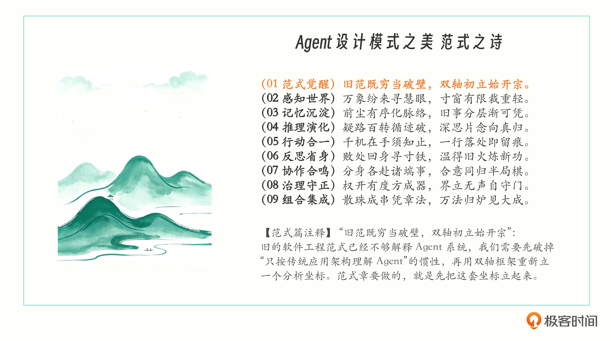

## 开篇三句话

> **GoF 解决"代码怎么组织"；**
> **分布式解决"服务怎么存活"；**
> **Agent 解决"模型怎么被约束地行动"。**

---

## 一、第一代 GoF 23 模式，用了 20 年的设计词汇

1994 年，四位计算机科学家（Erich Gamma / Richard Helm / Ralph Johnson / John Vlissides，简称 GoF 四人帮）合写了一本书叫《Design Patterns: Elements of Reusable Object-Oriented Software》（设计模式：可复用面向对象软件的基础）。书中给面向对象编程立起了 23 个可复用模式，成为了软件工程历史上影响最深的书之一。

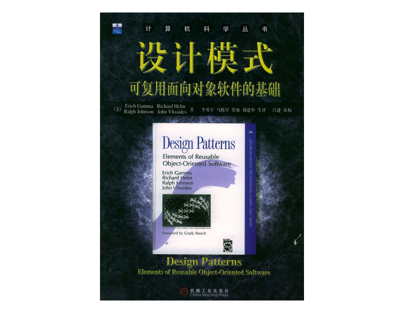

GoF 的 23 种设计模式，本质上就是 23 种写程序时常见问题的经典解法。简单来说有三类。

| 类别 | 回答的问题 |
|---|---|
| 创建型 | 怎么把对象"造出来"更灵活 |
| 结构型 | 怎么把对象"拼起来"更合理 |
| 行为型 | 怎么让对象之间"配合工作"更顺畅 |

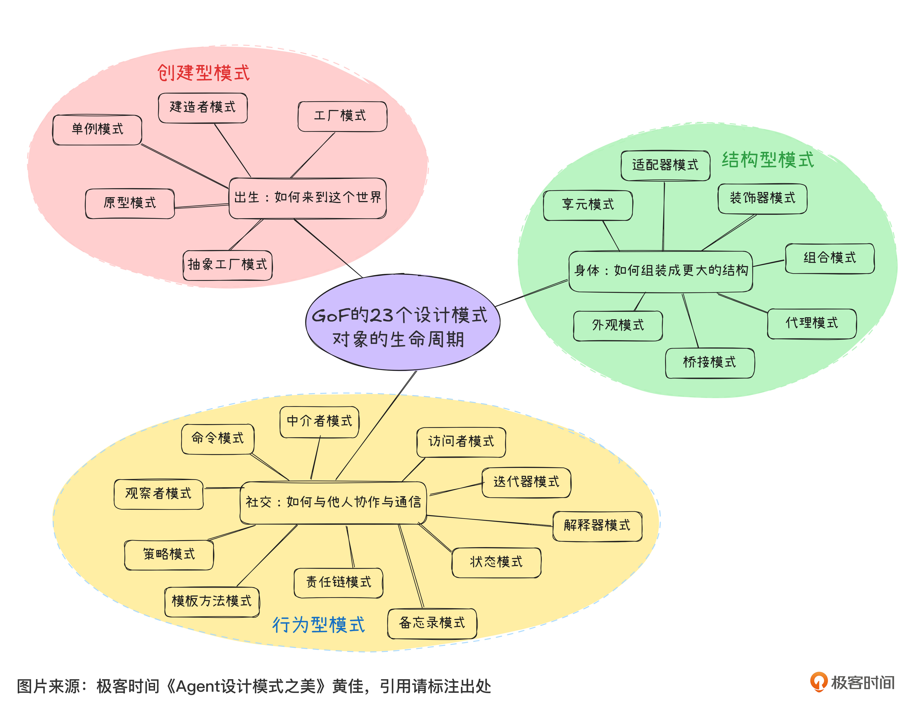

这 23 个模式不是凭空发明的。往上追溯，模式语言这个概念来自 1977 年建筑学家 Christopher Alexander 的《A Pattern Language》。Alexander 当年在做城市规划，发现"好的城市不是设计出来的，是从一组反复出现的好模式涌现出来的"，他把这套思路写成了一本厚书。GoF 把 Alexander 的"建筑模式语言"搬到了软件工程，建立起这 23 个面向对象的可复用模式。

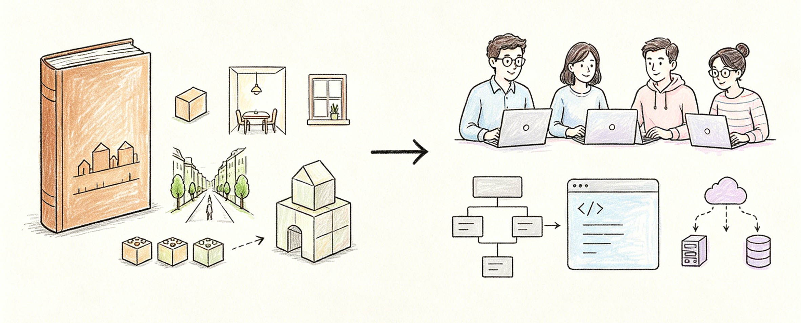

> **无论建筑还是 IT 工程，好的设计都是从一组反复出现的好模式涌现出来的。**

GoF 23 模式的工程价值，无非是做好这两件事：

1. **提供共同词汇**。Singleton、Factory、Observer、Strategy 这套词汇我们用了 20 年。它让我们能在 5 分钟里跟同事讨论一个系统的结构，让我们审查代码时能说"这里该用 Strategy 不该用 Switch"，让架构图能用一句"这是 Observer 模式"代替三页文档。
2. **把编码工程经验抽象出来**。这 23 个模式都是从工业实战里萃取出来的好实践，我们不需要重新发明轮子。

> **GoF 的共同底层假设：单进程 / 共享内存 / 同步调用 / 确定性失败。** 所有对象在一个进程里跑，状态在共享内存里改，函数调用同步返回，失败就抛 Exception。这套假设在 1994 年成立、在 2000 年还成立，到了 2010 年代分布式系统开始大规模铺开，这套词汇突然不够用了。

---

## 二、第二代 2010 年代 分布式系统模式

2010 年代我们经历了一次大规模的工程范式之变：从单机走到了集群。Microservices / Kubernetes / Service Mesh 一波接一波，GoF 的每一条底层假设都受到冲击。

| GoF 假设 | 分布式现实 |
|---|---|
| 共享内存 | 网络分区（节点之间不能瞬间看到对方状态） |
| 同步调用 | 异步消息（调用方等不到响应可能就是消息丢了） |
| 单点失败 | 部分失败（一个集群里 30% 节点挂了系统仍要工作） |
| 确定性 | CAP 三选二（Consistency / Availability / Partition tolerance 不能全要） |

GoF 的 Observer 在分布式里失效了，你想给 1000 个 subscriber 同步推 event？网络不允许。你想用 Singleton 管全局配置？跨集群没有全局。整套词汇得重新建立。因此，接下来的 10 年涌出了一批新模式，也就是第二代设计模式——分布式系统模式。作者选了 9 个最经典的做成了表格。

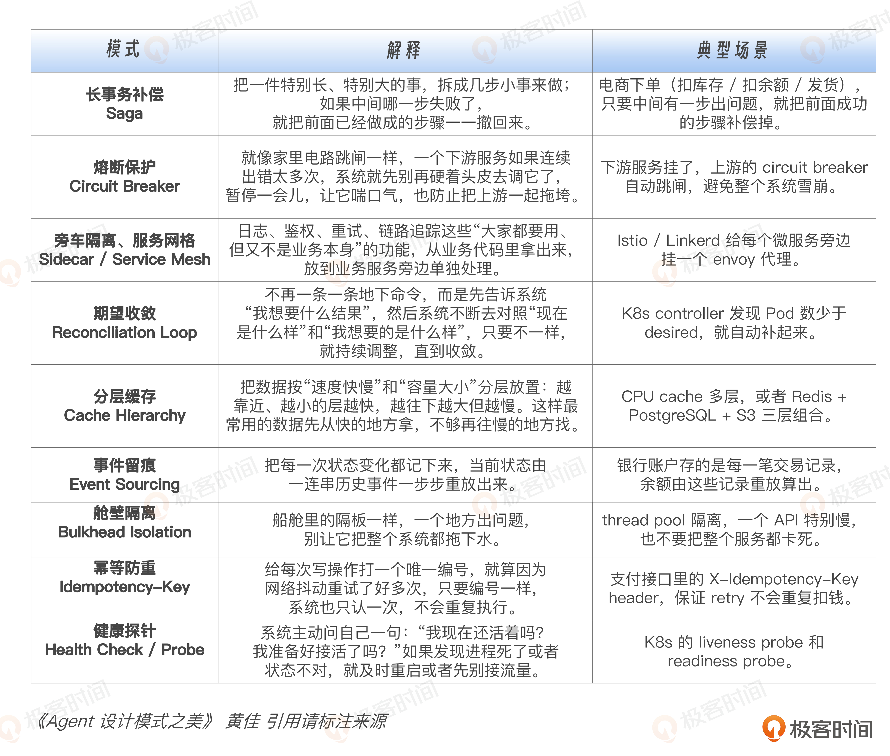

> **这 9 个分布式模式的共同特征：都把"不确定性"作为首要关注点来处理。** GoF 假设失败是 Exception，分布式假设失败是 default，每一个模式都是在不确定性下保证系统行为可靠的工程纪律。

做过 5 年以上微服务的同学，这 9 个模式应该都熟。如果还不熟，推荐 Michael Nygard 的《Release It!》——分布式工程模式的奠基书，地位类似 GoF 之于面向对象时代。

> 到这里：第一代 23 模式 + 第二代 9 个核心模式 = **32 个旧模式**。这就是 2024 年 LLM、Agent 出现之前，我们做工程决策时用到的主流词汇。

---

## 三、第三代 Agent 模式，解决"模型怎样被约束地行动"

第三代 Agent 模式所要解决的，已经不再是传统意义上"代码如何组织"或"服务如何协作"的问题，而是"**模型怎样被约束地行动**"。

很多人一谈 Agent 就容易把它讲得很玄，但如果把它放回整个软件工程的演进脉络里看，其实它并不神秘，它只是把系统的核心难题又往前推进了一层：**第一代的核心是对象协作，第二代的核心是服务协作，而第三代的核心则变成了模型协作。**

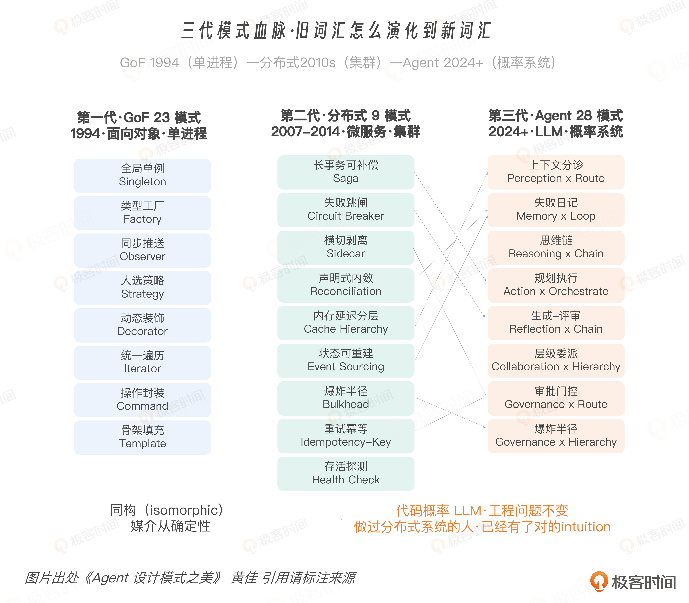

表面上看，这似乎只是词汇的变化，但背后的工程含义其实非常深刻：过去我们写的是**逻辑**，系统按预先写好的逻辑执行；后来我们设计的是**边界**，让服务在预设边界内彼此调用；而现在，我们面对的是一个会在运行时自己决定"看什么、想什么、调什么、做什么"的系统部件。

> **Agent 时代最深的变化，并不是又多了一个 AI API，也不是又多了一个工具协议，而是决策的位置发生了迁移：** 在 GoF 模式里，关键结构决策默认由人在设计阶段做出；而在 Agent 系统里，大量关键决策开始转移到运行时，由模型在不确定环境中动态生成。
>
> 一旦这一点发生，旧模式就不会彻底失效，但会开始**失重**。它们依然存在，依然有价值，却已经不足以完整解释我们今天面对的新问题。

---

## 四、模式崩塌：GoF 模式在 Agent 时代如何断裂

2024 年 LLM agent 大规模铺开之后，GoF 和分布式的某些假设依然有效，但很多常用的模式各自以不同方式断裂。拿 GoF 里四个广为人知的模式来看。

### Singleton 断裂，因为状态不再全局共享

经典 Singleton 保证全局只一个实例：一个数据库连接池、一个配置管理器、一个 Logger。基础假设是**状态持久共享**，所有调用者看到同一份内存里的同一份数据。

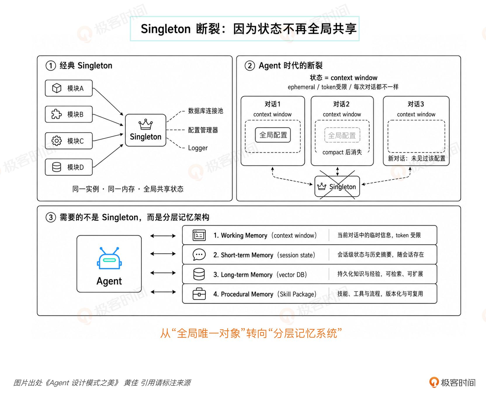

Agent 的状态受上下文窗口所限，有 token 上限，且每次对话都会被重置。你想在里面放一个"全局配置管理器"，第一次对话能塞进去；用户聊到一定 token、上下文在压缩的过程中万一你的全局配置消失了，Agent 就没法找回。再开启一段新对话时，它压根没见过你的全局配置（你也许还以为：我之前和它说过了呀😀）。

这里需要的不是 Singleton，是**分层记忆架构**——工作记忆 / 短期记忆 / 长期记忆 / 程序性记忆四层，将是第三模块"记忆·沉淀之美"整章要讨论的内容。

### Factory 断裂，因为动作空间在编译期是开放的

经典 Factory 从固定分类造对象——`createSedan() / createSUV() / createTruck()`。基础假设是**产品类型在编译时已知**。

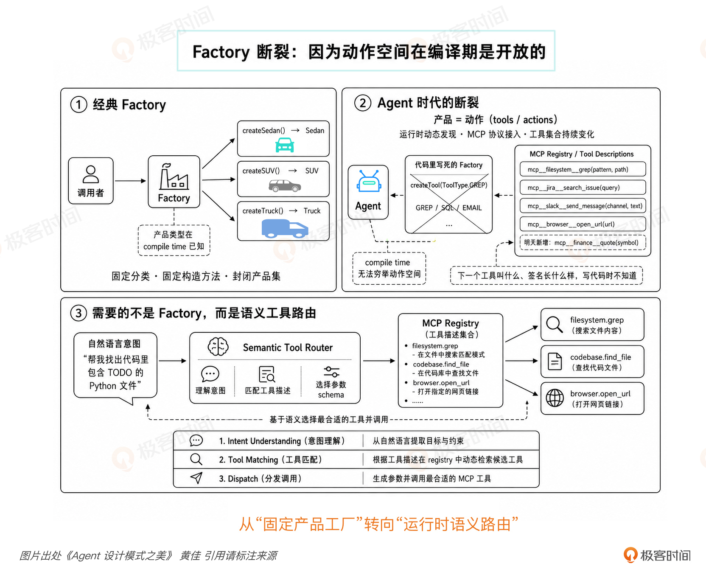

Agent 的"产品"是**动作**，而动作空间根本不是编译期的。MCP 协议（Model Context Protocol）让 Agent 在运行时动态发现新工具——你今天部署的 Agent，明天可能就接到一个昨天不存在的 MCP server。`createTool(ToolType.GREP)` 这种写法在 Agent 世界里根本写不出来，因为下一个工具叫什么名字、签名长什么样，写代码的时候不知道。

这里需要的是**语义工具路由（semantic tool routing）**，让 Agent 根据自然语言意图，动态匹配 MCP registry 里的工具描述（第 20 讲工具调度时讲透）。

### Observer 断裂，因为同步推送会自爆

经典 Observer 同步通知所有订阅者：状态变化触发回调，所有 subscribers 立刻收到。基础假设是**推送可靠且廉价**。

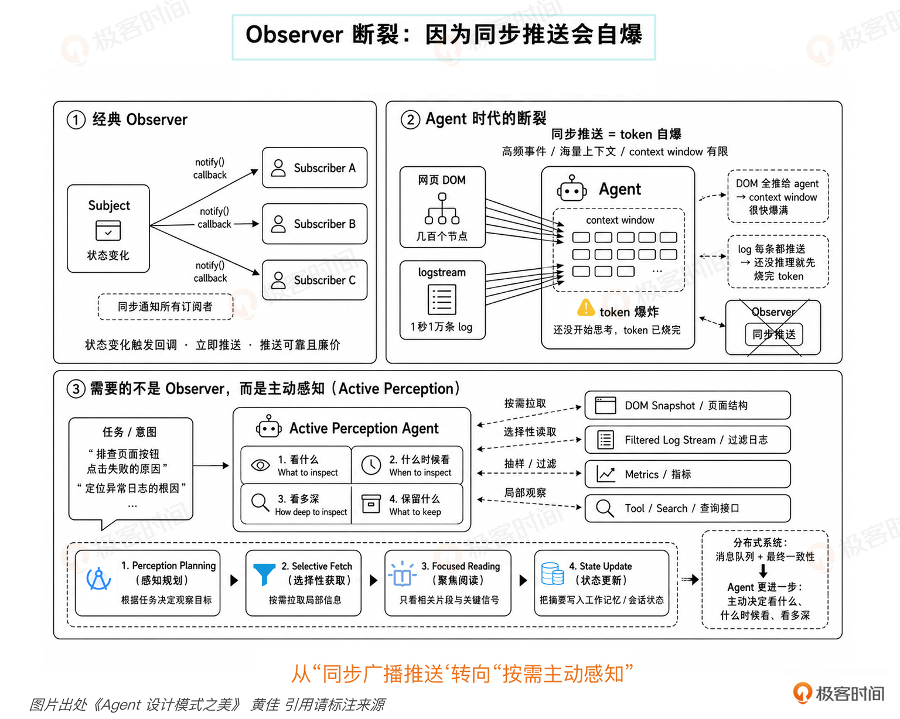

让 Agent 浏览一个网页，DOM 节点几百个，你要是把 DOM 树全推给它做 Observer，上下文窗口很快就爆。让 Agent 监控一个 logstream，一秒一万条 log，每条都推送过来，还没等 Agent 想任何事情，token 已经烧完了。分布式系统当年是通过消息队列 + 最终一致性解决了类似问题；Agent 系统比这个还要再进一步——**主动感知（active perception）**，Agent 自己决定看什么、什么时候看、看多深（第二模块"感知世界之美"深入剖析）。

### Strategy 断裂，因为人不再选策略

这个最有代表性，单独拎出来讲。

经典 Strategy 长这样：`calculator.setStrategy(new VIPPricing())`，开发者在编码时决定用哪个策略。Strategy 模式的整个工程价值，就在于让策略切换从硬编码变成参数化。**但切换决策本身仍然在开发者手里。**

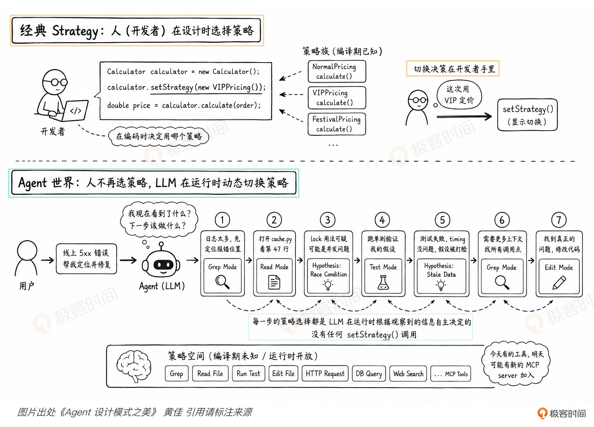

回到 15 分钟修 5xx 的例子：Claude Code 修这个 bug 走了 7 步——grep 定位、读文件、形成假设、跑测试、被打脸、改假设、再写代码。**这 7 步里没有任何一次 `setStrategy()` 调用。** 每一步的策略选择都是 LLM 在运行时根据"我现在看到了什么"自己做的：

- 看到 `cache.py` 第 47 行的 lock 用法可疑 → 切到 race condition；
- 假设"测试失败，但不是 timing 的问题"（和操作次序无关）→ 切到 stale data；
- 假设需要看更多 caller → 切到 grep mode；
- 寻找所有 `cache.get` 调用点。

如果是在 GoF 时代，每一个箭头切换都得是一个 `setStrategy()` 调用、一个开发者 design time 写好的分支。而在 Agent 世界里，**每个箭头都是 LLM 在运行时自己画出来的**。Strategy 模式没消失，它被搬到了 Agent 脑子里，由 LLM 在每一步动态切换。

### 根因：决策权从开发者搬到大模型

把这四种断裂放在一起看，根因是同一个：

> **GoF 所有模式假设架构师在设计时做出所有结构性决策。Agent 系统要求由系统本身在运行时、不确定性情况下做出决策。**
>
> **GoF 是编译期决策 + 运行时执行；Agent 时代是运行时决策 + 运行时执行——决策权从开发者手里搬到了 LLM 手上。** 这个搬家足以让 GoF 整个 23 模式集体失重。

落到代码层面，这四种"搬家"长成下面这样（作者建议印一份贴电脑上）：

| GoF 断裂模式 | Agent 时代接替者 |
|---|---|
| Singleton | **MemoryArchitecture**（03 记忆模块 · 4 层记忆） |
| Factory | **SemanticToolRouter**（04 行动模块 · 工具调用与 MCP 语义匹配） |
| Observer | **ActivePerception**（02 感知模块 · Agent 自己决定看什么） |
| Strategy | **LLM 在 `reason()` 里每一步自己挑** |

> 这门课讲的 28 个新模式，每一个都在回答这个问题：**当决策权在 LLM 手上时，工程师该怎么搭框架，才能让 LLM 的决策稳定 / 可审计 / 可复用。**

---

## 五、血脉进化：分布式模式在 Agent 时代继续演进

从第二代到第三代，旧模式没有消失，它们被**推进了一层**。模式的三代演化图并不是在做"新旧替换表"——Saga 换成什么、Bulkhead 换成什么。真正准确的说法是：

> **第二代模式处理的是服务世界的不确定性，第三代模式处理的是模型决策的不确定性。问题还在，但承载问题的对象变了。**

可以这样理解这条血脉："长事务补偿"（Saga）到了 Agent 时代，会进化成"**规划—执行**"。为什么？因为 Agent 的任务本来就不是一步完成：模型先拆任务，再执行步骤，执行中失败了，还得根据当前状态重新规划。**以前补偿的是数据库状态，现在补偿的是任务推进路径。**

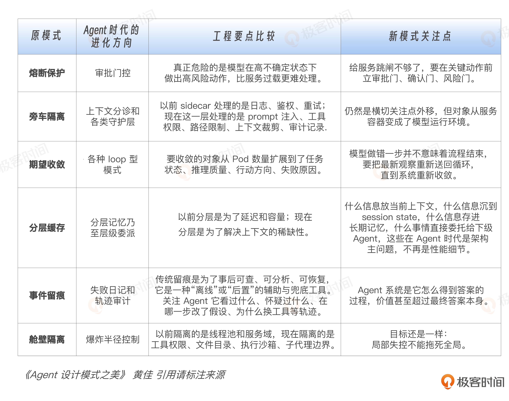

> 第二代和第三代之间是**推进**的关系，不是断裂。旧模式没有过时，旧模式是被"抬高了一个层次"。
>
> 但为什么到这里，很多人还是会觉得传统模式不够用了？**因为真正崩的不是某一个具体模式，而是"系统默认可控"这个前提。**

---

## 六、模式演进的根因：三种不确定性

如果说 GoF 的前提是确定性执行，分布式的前提是不可靠网络，那么 Agent 时代的新前提，就是**高强度的不确定性**。

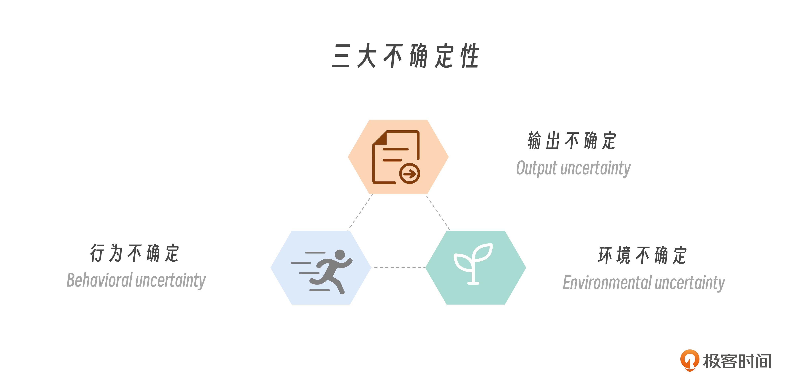

| 不确定性 | 含义 | 对经典模式的冲击 |
|---|---|---|
| **① 输出不确定** Output uncertainty | 同一个 prompt，模型跑十次可能给十种不同答案 | 传统 retry 假设幂等；LLM 调用的重试可能得到完全不一样的答案，引出新的行为分支。熔断器、幂等键这些经典工程模式整套要重新装一遍 |
| **② 行为不确定** Behavioral uncertainty | Agent 自己决定要不要调工具、先调哪个、要不要问澄清、要不要继续思考 | 行为轨迹不再是代码里写死的流程图。ReAct Agent 在 Reasoning 和 Acting 之间循环切换，循环长度、内容、每一步做什么都不是设计阶段能预测的 |
| **③ 环境不确定** Environmental uncertainty | Agent 操作的世界本身在变 | 浏览网页的 Agent，今天看到的页面布局明天可能变了；写代码的 Agent，上次读过的 Codebase 可能已被同事改过。世界不会停下来等 Agent |

传统软件工程把不确定性当**边缘情况**来处理：try-catch 一下、retry 几次、超时报错。大家会觉得加个 retry、schema 校验、timeout 就稳了——这是 try-catch 思路，它治不了 Agent 系统。

> **Agent 工程必须把不确定性当作默认运行条件。** 也就是说，要从一开始就默认系统会漂、会偏、会重复、会失控，在这个前提下设计结构，不能等出了问题再打补丁。

---

## 七、真正的新地基：Harness

地基（前提）变了，软件工程系统的重心也就不同了。当系统的关键决策越来越多地在运行时由模型作出时，工程师的工作重心就发生了迁移：**过去我们主要是在写功能逻辑，现在我们越来越多是在设计边界条件。**

工程师定义的范围扩展了。除了"系统做什么"，还要定义：

- 模型在**什么上下文**下思考；
- 模型能**看到哪些信息**；
- 模型能**调哪些工具**；
- 模型在**什么条件下必须停下来**；
- 模型**做错以后**，系统如何把它拉回来；
- 模型**做过什么**，谁来留痕，谁来审计。

> **这一整层，不是 prompt。这一整层，就是 Harness。**
>
> Harness 在模型思考之前、之中、之后，给它立边界、留痕迹、做审计。它不替代模型思考。

请记住这个重要的工程判断（贯穿整个课程）：

> **Agent 架构，就是在不确定性之下设计有界资源的分配。**
> *Agent architecture is the design of bounded resource allocation under uncertainty.*
>
> 更口语一点说：**模型负责花钱，Harness 负责管账。**

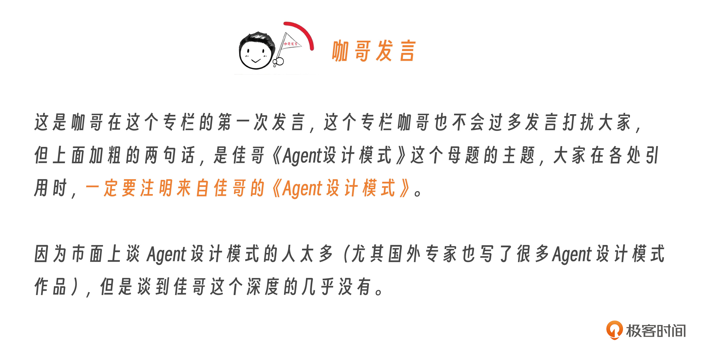

为什么是"花钱"和"管账"？到了 Agent 世界里，**token 是钱，context 是钱，工具调用是钱，wall-clock 是钱，用户信任是钱，不可逆动作的风险也是钱**。模型天然擅长生成可能性，但它不天然擅长节制：它会花，会试，会探索，会走弯路。真正的问题是它花到哪里、花多少、什么时候该停——模型会花是默认前提。于是 Harness 的意义就出现了：

> **它不负责创造智能，它负责约束智能的开销与后果。**

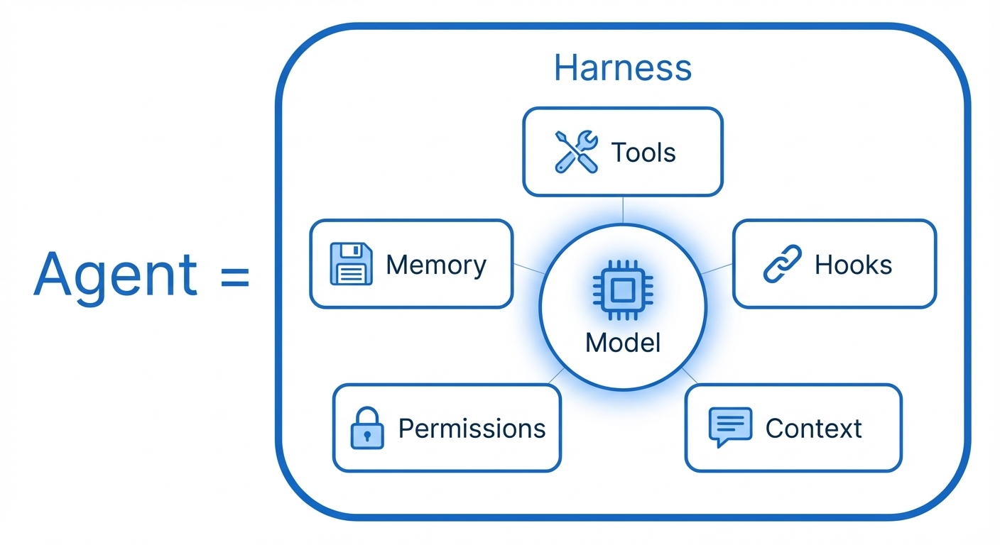

到这里，从 GoF 到分布式再到 Agent 的演进终于闭环了：

> **GoF 教我们组织代码；**
> **分布式模式教我们驯服网络；**
> **Agent 时代则逼着我们去驯服模型的运行时决策。**
>
> 而驯服这件事，靠的就是整套 Harness 工程。

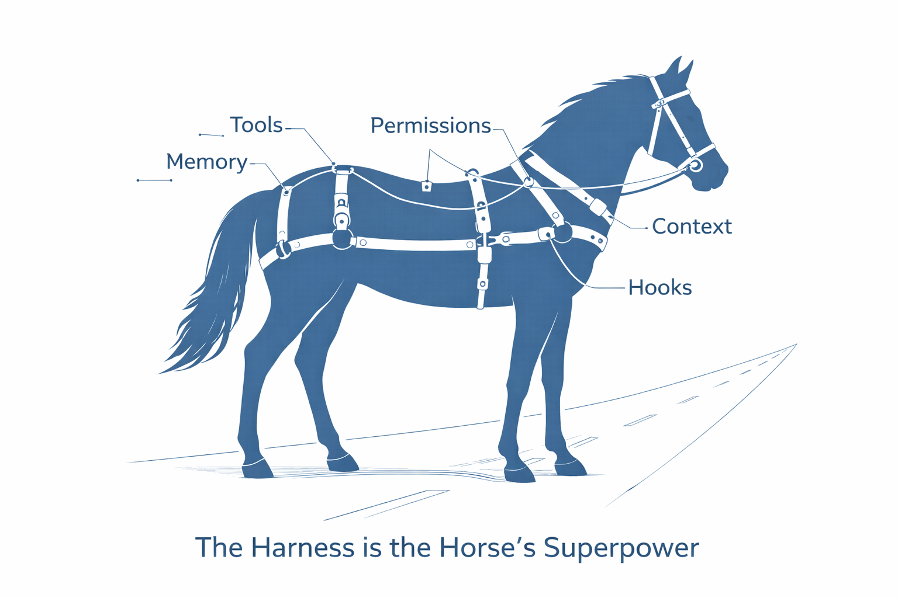

> **Harness 是新一代工程师的最高杠杆工程。** Agent 时代最值钱的，不再只是"让模型会做事"，而是"让模型持续稳定地做对事"。
>
> 发现一个错误：只改 prompt，往往是让它"这次别犯"；改 Harness，是在设计一种机制，让它"以后都别这么犯"。**这就是工程和调参最大的分界线。**
>
> 调 prompt，是局部修补；做 Harness，是把局部错误上升为系统纪律。

所以我越来越相信，新一代工程师最重要的能力，是能把企业的**流程、知识、权限、风险、审计**，沉淀成一套 Agent 可以消化、可以复用、可以持续迭代的 Harness 结构。写几个只存在于 PPT 展示、看起来很炫的 Agent demo 谁都能做，再包一层 Workflow 也算不上真正的工程能力。**你做的是企业未来的智能操作系统外壳。**

---

## 八、双轴正交框架的提出：这一代的"GoF 词汇"

到这里我们已经完全看清，第三代 Agent 模式正在涌现，时代呼唤新的范式。这门课要建立的就是 **Agent 时代的"GoF 词汇"**。

如果今天面对的只是几个新技巧，那完全没必要再立一整套模式词汇。但问题在于，Agent 时代的模式已经不是 GoF 那种"对象怎么构造、怎么组合、怎么协作"的问题了，它的核心张力变成了另一件事：**资源花在什么地方，以及资源是怎么被花出去的。**

作者最终决定，不沿用 GoF 的"创建型、结构型、行为型"三分法，也不跟着分布式时代"来什么问题解决什么问题"的见招拆招套路，而是提出一套更适合 Agent 的坐标系：

| 轴 | 名称 | 内容 |
|---|---|---|
| 第一条轴 | **认知功能** | Agent 到底在做什么：感知、记忆、推理、行动、反思、协作、治理 |
| 第二条轴 | **执行拓扑** | 这些能力怎样流动起来：链式、路由、并行、编排、循环、层级 |

> 前者回答的是：**资源花在哪里**。后者回答的是：**资源怎么花出去**。

这 28 个 Agent 模式构成了 Agent 时代新的"共同词汇"，给我们一套可以共同讨论 Agent 工程问题的语言。就像 GoF 当年给面向对象时代立起语言一样，这套双轴框架要给 Agent 时代的工程设计立起一张真正能用的地图。

---

## 总结一下

今天这一讲最重要的，是记住一条完整的**血脉**。具体的定义，以后可以查、可以补。

- 第一代 GoF 模式，解决的是**代码对象怎么组织**；
- 第二代分布式模式，解决的是**系统在不可靠网络中怎么存活**；
- 第三代 Agent 模式，解决的是**模型在高不确定环境中怎样被约束地行动**。

第二代不是把第一代推翻，第三代也不是把第二代推翻。它们是一道道往上推进的**问题升级**：对象协作之后是服务协作，服务协作之后是模型协作。

> **真正让第三代成立的，是系统决策位置的迁移——从开发者的设计时，搬到了模型的运行时。** 多一个 LLM API 还不至于。一旦决策权搬家，模式就必须跟着搬家。而一旦模式开始搬家，工程师的最高杠杆也跟着搬家：从写功能，搬到了设计 Harness。

但 28 个新模式不能像 GoF 那样按创建、结构、行为分 3 类，因为 Agent 模式的核心张力不在"做什么对象操作"，而是"**花什么资源 × 怎么花**"。

> 这门课后面要讲的 28 个模式，归根结底都在回答同一个问题：**当模型开始在运行时自己做决定，工程师该怎样搭一个框架，让这些决定仍然稳定、可审计、可复用、可进化？这，就是 Agent 设计模式真正要回答的命题。**

---

## 思考题

1. 你认为作者提出的三代设计模式演进、尤其是 Agent 时代模式变迁的根因（决策权搬家 + 高不确定性）是否到位？有何深刻与不足之处？
2. **GoF 模式自检**：你的项目里写过哪几个 GoF 模式？挑 3 个用得最多的，说说各自的核心假设是什么（单进程 / 同步 / 类型已知等）？
3. **分布式模式自检**：你做过的微服务系统里用了 9 个分布式模式中的哪几个？哪些是生产系统中不可或缺的？
4. **GoF 断裂自检**：你项目里最关键的几个类（配置管理器、连接池、事件总线、策略容器……）改造成 Agent 跑的版本，会先碰到哪种断裂？
5. **Harness vs Prompt 优先级**：如果给你 1 周时间提升一个 Agent 的可靠性，你选 (a) 调 prompt 让模型这次别犯错，还是 (b) 改 harness 让模型永远没机会犯错？为什么？

---

## 下一讲预告

下一讲重点讨论**双轴正交框架**（Two-Axis Framework）的具体内涵、**28 个模式的典型例子**以及**逆向五步法**。

> 双轴框架和 28 个模式是这门课的核心 IP。看完 02、03 两讲，整门课的脊柱就立起来了：本讲建立范式与理论框架，下两讲建立坐标系 + 工程方法论，然后从下一个模块开始系统探讨一个个模式的变体、代码示例和实现。

---

## 留言区精华（作者黄佳亲自回复）

> 📌 本节收录前 10 条精华；**全部 32 条留言按点赞排名 + 思考题最佳回答，见 [01-范式之变-思考题与讨论](01-范式之变-思考题与讨论.md)**。

### ① 环境变化，Agent 怎么同步状态？（AIKO Nexus，置顶 · 7 赞）

**问**：环境不确定性下，Agent 是不是应该有主动更新的同步机制，而不是每次执行任务时被动"后知后觉"用了旧信息？是外部环境变了主动触发，还是定时更新？

**作者回复**：当然需要有完善的从环境中不断吸收最新状态的机制。**Loop Engineering 的内核，不外乎就是判断随着情况的变化而不断的变化。** 感知模式里的渐进加载、记忆模式里的失败日记（尤其情节记忆的召回触发点）都在讲这个方向。工作流编排有四种可能：

| 机制 | 做法 | 优缺点 | 适用 |
|---|---|---|---|
| Pull-on-demand 懒拉取 | 每次任务开始现拉最新 | 简单、无过期问题，但付出查询延迟，不知道两次拉取之间发生了什么 | 调用频率低、延迟不敏感、状态变化平缓 |
| Periodic refresh 定时刷新 | 状态加 TTL，过期重拉；或后台定时全量刷新（RAG 索引夜跑 embedding） | 延迟与新鲜度可控折中；TTL 窗口内仍是旧的 | 中等变更率 |
| Event-driven invalidation 事件驱动失效 | 上游变了主动推送事件（消息队列、webhook、CDC） | 几乎实时；但需要 pub/sub、顺序保证、处理乱序事件 | 高变更率 + 高影响 |
| Hybrid 混合 | 按数据冷热分层 | 热数据→Event-driven；温数据→Periodic refresh；冷数据→Pull-on-demand | 生产系统几乎都是这种 |

### ② GoF 四模式与 OODA 环同构（PatrickL，置顶 · 40 赞）

**发现**：GoF：观察者→单例→策略→工厂 = OODA 环：Observe→Orient→Decide→Act。

**作者回复**：OODA 环是经典决策闭环模型，来自美国空军上校 John Boyd 的军事决策思想：看见变化 → 理解局势 → 做出选择 → 采取行动，再观察新结果、继续循环。《Designing AI Agents》中详细拆解了从 OODA 环到 ReAct 再到 Agentic Loop 的进化线。人、军队、企业、软件系统、AI Agent，只要面对不确定环境并持续行动，都绕不开这个环——**这就是 Harness 核心**。

GoF 四模式确实构成对象系统里的运行闭环：

- 观察者模式：感知变化（Observe）——谁变了、谁需要被通知；
- 单例模式：稳定的状态锚点 / 全局上下文（Orient）——把观察到的信息放进已有上下文理解；
- 策略模式：从多个可替代方案中选择行动路径（Decide）；
- 工厂模式：生成执行对象、落地行动结构（Act）。

### ③ 三代模式是叠加，不是替代（111 · 23 赞）

**观点**：论述中 GoF 和分布式模式显得"失重"了，实际上 Agent 系统底层仍运行在分布式基础设施上，Agent 的代码仍需要 GoF 模式组织（只是不再是决策主体）。Agent 越复杂，对传统工程能力要求越高——容错、监控、日志、审计都更困难了。三代模式是叠加关系而非替代关系。未来 Agent 架构重心将从"功能架构"迁往"约束架构"（LangSmith 的演进佐证：从监控到问题识别、预警、基于数据迭代）。

**作者回复**：完全同意。"**Agent 时代，传统软件工程反而更重要了，因为复杂度是叠加，而不是替代的关系。**"（作者表示暂不改动原文，供大家审视探讨，回头调整说法，让脉络更清晰。）

### ④ 第二代分布式模式书单（Porter Zhang · 14 赞）

**作者回复**：

1. 《Building Microservices》——最流行的微服务入门经典（封面一堆小蜜蜂和蜂巢，很有设计隐喻感）
2. Chris Richards《Microservices Patterns》——微服务设计圣经
3. 《Cloud Native Patterns》——云原生 / Kubernetes 路线
4. 《DDIA》——分布式数据系统理论集大成者（作者的 DAA《Designing AI Agents》就是对标这本书写的）
5. 《Site Reliability Engineering》SRE book——Google 工程体系圣经
6. ……未完待续

### ⑤ Harness vs Prompt 实践案例（爱海贼的无处不在 · 11 赞）

**观点**：2026 年开始提示词不够用了。同事生成代码没写 Java 注释，别人提醒在宪法或 agents.md 加提示词，而我会从 harness 角度增加控制：① 代码生成完成后触发自动检测补注释的 skills；② 针对 java 文件的特殊规则文件；③ hooks 让 AI 生成后检查是否有注释；④ subagent 机制编排补注释和文档。自己环境加提示词未必保证别人电脑也好使；从 harness 机制上做，可以让代码交付更稳定。

**作者回复**："**Prompt 告诉模型该怎么做，Harness 解决即使模型没完全按预期做，系统也能把结果拉回正轨。** Java 注释这个例子特别典型：只靠 prompt，本质是期待模型一次性听话；用 harness，就是把'是否有注释'变成**可检测、可修复、可回撤、可复验**的工程环节。"

### ⑥ ELK 日志挤爆上下文，模型不守规矩怎么办？（Geek_23ba06 · 4 赞）

**问**：用 openCode + 自定义 elk_query 技能查 ELK 日志定位现网问题，日志量大易占满上下文频繁触发压缩。已在 AGENTS.md 写明"用子 agent 执行 elk_query"，但上下文压缩后模型会忽视规则，又在主 agent 查日志。从 harness 工程角度应该怎么做？

**作者回复**：**应该把规则从"劝模型"升级成"模型绕不过去的结构"。从软到硬五级：**

- → L1 写 AGENTS.md（你现在这层）
- → L2 移进每轮重注入的 P0 区
- → L3 给 elk_query 加返回硬上限（超了自动截断 + 挂 handle）
- → L4 pre-tool-use hook 拦截调用方
- → L5 主 agent 根本不暴露 elk_query

**建议**：主 agent 只给一个 `investigate_logs(query, time_range, service)`，内部 spawn 一个便宜模型的 sub-agent，sub-agent 独占 elk_query 读原始日志，只回传结构化摘要 + log handle。主 agent 的 context 永远只进 200–500 token 摘要、原始日志一行不进，sub-agent 读完即销毁。"**这条规则不再需要模型去记得遵守，因为它已经变成架构的一部分。**"

### ⑦ 前端视角：把握不了模型生成方式（Cassie · 3 赞）

**观点**：以前写项目逻辑用 GoF 模式很有章法（单例、工厂、观察者、访问者），现在 aicoding 中把控不了模型生成的方式：加了一堆 MCP、skills、tools、agents.md，仍不能保证每次产出的确定性，看似定义了范式，执行结果还是有各种问题。

**作者回复**：这是生产一线的真实感知，很宝贵。**以前——"结构定义完 = 行为确定"；现在——"结构只能提高行为稳定概率"。** 工程目标从"绝对正确"变成"在不确定性下保持系统可靠"。**Agent Design Pattern 的本质和大原则是不确定性控制纪律，这就是设计反转**——以前的设计模式本质是程序结构和设计流程掌控技术。

### ⑧ 伟大的工程建立在驯服不确定性之上（yphust · 2 赞）

**观点**：其他学科早就证明，伟大的工程不是建立在确定性之上，而是建立在对不确定性的驯服之上——控制论驯服动态系统，统计学驯服随机样本，法律驯服人性与权力，保险驯服风险，航空驯服高危复杂系统，制造业驯服过程波动。而 Agent 时代，Harness Engineer 要驯服的是**模型的运行时决策不确定性**。

**作者回复**：Harness：如何约束、引导、隔离、放大、抑制、修正模型在运行时产生的不确定行为。"**没法让模型永远正确，而是在模型注定会犯错的前提下，依然让系统持续产生正确结果。** 这和分布式系统里的 CAP 权衡理论有天然的血缘相似性。"

### ⑨ 游戏主程的 Agent 实践路径（黄丞 HUANG Cheng · 2 赞）

**问**：游戏主程，用 Claude Code 和 DeepSeek 搭建 AI 促进开发，想趋近"一人公司"的开发与代码评审流程，从哪儿开始？

**作者回复**：正交框架是一个启发，让你在游戏设计中用 agentic 思维解决各种场景的具体问题。把每个模式深入讨论清楚后，你会发现系统里很多地方都可以 agent 化——这就是**一个一个的单点突破**。单点突破之后，再从整体上思考怎么把系统演化成一个**能够自身进化的"系统的系统"**，让它更灵活自主。这是在实践中不断演进的体感，最后需要你把这些模式一个个在游戏设计过程中落盘。

### ⑩ 配图彩蛋（May · 3 赞）

读者盛赞本讲从上帝视角抽象 30 年软件工程经验、建立双轴框架；**作者回复提到：本课配图是中国传统国画风**。

---

## 一句话总结

> **决策权从开发者搬到大模型，是三代模式演进的总根因；Agent 架构就是在不确定性之下设计有界资源的分配——模型负责花钱，Harness 负责管账。**

---
*笔记生成时间：2026-10-14 · 图片版权归属原出处，仅作个人学习收藏*
