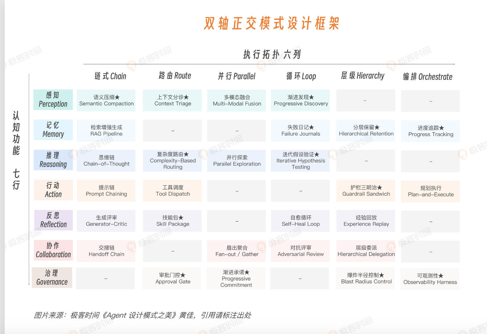
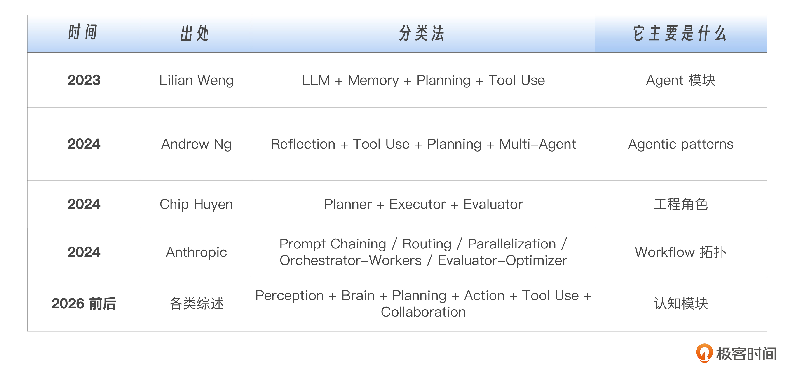
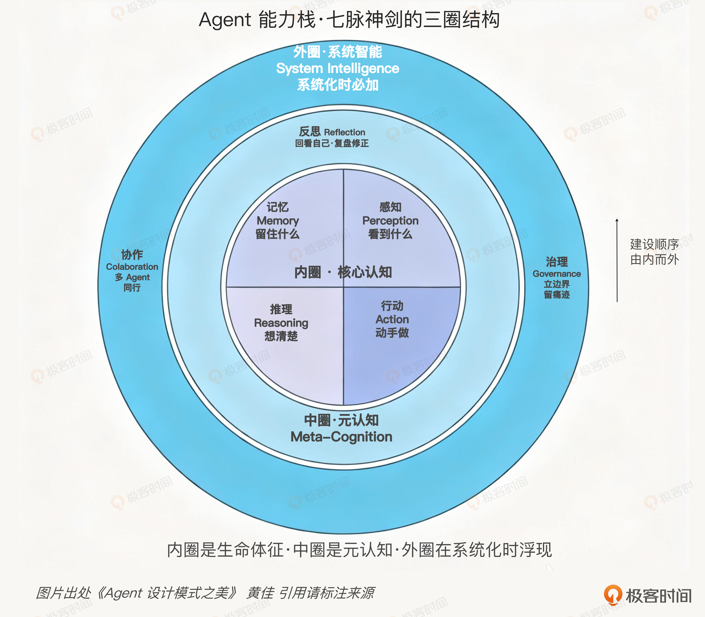
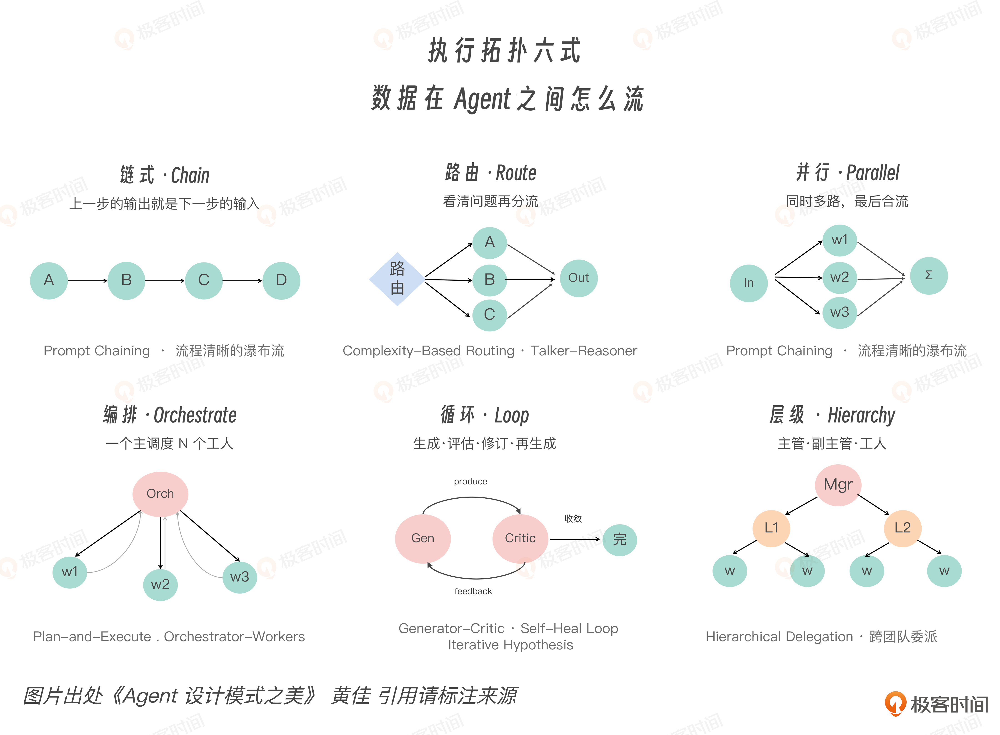
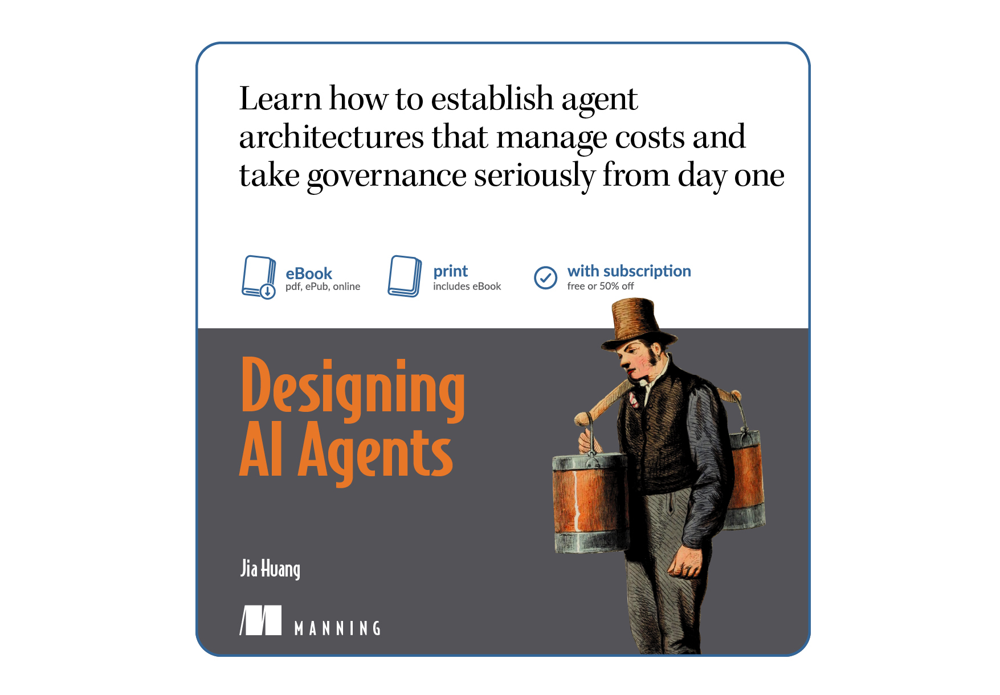

# 02｜双轴框架（上）：理解认知功能与执行拓扑

> 《Agent 设计模式之美》第 02 讲 · 黄佳 · 核心命题：纵轴"认知功能"七脉回答 Agent 在消耗哪种资源，横轴"执行拓扑"六式回答资源与错误如何在系统里流动——双轴既立，Agent 工程评析才真正入微
> 原文链接：<https://time.geekbang.org/column/article/980743>
> 📝 相关笔记：[速览版](02-双轴框架（上）-速览版.md) · 💬 [思考题与高分讨论](02-双轴框架（上）-思考题与讨论.md) · 🧠 [在浏览器中打开脑图](http://127.0.0.1:8765/notes/agent-design-patterns-beauty/02-%E5%8F%8C%E8%BD%B4%E6%A1%86%E6%9E%B6%EF%BC%88%E4%B8%8A%EF%BC%89-%E8%84%91%E5%9B%BE.html) · 或双击本地文件 [02-双轴框架（上）-脑图.html](02-双轴框架（上）-脑图.html) · 上一讲：[01-范式之变笔记](01-范式之变-速览版.md)

## 开篇：从三句话到双轴坐标系

上一讲把地基打下来了：**GoF 解决代码怎么组织，分布式解决服务怎么存活，Agent 解决模型怎么被约束地行动。**

这三句话看起来像历史分期，其实是三种工程权力的转移：

| 代际 | 权力交给谁 |
|---|---|
| 第一代 | 对象结构 |
| 第二代 | 服务边界 |
| 第三代 | 模型（一部分决策权）——然后由 harness 把边界重新收回来 |

> **真正重要的是：Agent 时代的设计模式，不再只是在回答最终的代码长什么样，而是在回答"一个不确定的模型，在有限资源里，应该把注意力、记忆、推理、工具、权限和责任分别放到哪里"。**

这就是双轴正交框架要解决的问题：

- **纵轴 · 认知功能**：回答 Agent 在做什么——它是在看、记、想、做、反思、协作，还是治理自己。
- **横轴 · 执行拓扑**：回答数据和控制怎么流动——它是链式传下去、路由选出去、并行撒出去、集中编排、循环收敛，还是层级委派。

> 两轴合起来，才给每个模式一个唯一坐标。没有这个坐标，"我们用了一个 agent workflow"这句话几乎没有信息量；有了这个坐标，"我们用了推理 × 循环的迭代假设，加治理 × 路由的审批门控"这句话就能进入工程评审。

本讲解决三件大事：

1. **为什么现有分类不够**：业界 5 类主流说法为什么都只摸到了局部；
2. **把两根轴讲透**：纵轴背后是能力从个体认知到系统智能的层级，横轴背后是错误、成本、延迟和责任的传播路径；
3. **变成工程工具**：拿到业务需求怎么查表选模式，看到开源框架怎么判断覆盖了哪些格，评审 Agent 架构怎么问出真正的问题。

在此之后，后面所有模式就不再是散落的术语，而会变成一张**可以导航、可以评审、可以扩展的地图**。

---

## 一、我是怎么发现双轴框架的

> 起因：给 Cisco Agent 团队做培训前沟通时，一位学员问"你是怎么一步步把这个双轴框架落地、设计出来的？"——佳哥的回答是：跟 Cisco 的产品一样，是在不停迭代过程中进化到这一步的。

### 1. 分布式时代："问题 → 模式"就够了

回到上一讲那些"古早"分布式模式：Circuit Breaker、Saga、Sidecar、Bulkhead、Idempotency Key、Reconciliation Loop——它们都是**"问题 → 模式"**的组织方式：

- 网络会挂，所以要熔断；
- 跨服务事务会失败，所以要补偿；
- 横切关注点散落，所以抽成 Sidecar。

这种"见招拆招"在分布式时代很有效，因为**问题高度可命名**：延迟、故障、重试、幂等、隔离、观测。

### 2. Agent 时代：组合密度更高，问题清单不够了

原因很简单：**Agent 模式之间的组合密度更高**。一个生产级 Agent 很少只用一个模式：

> 一个代码评审 Agent 可能同时有：上下文分诊、分层记忆、复杂度路由、工具调度、生成评审、审批门控、可观测性。它们是**互相影响的预算系统**：上下文分诊影响推理质量，推理路径影响工具调用，工具结果影响反思，反思又可能触发重新检索或重新计划。

如果没有坐标，架构评审会变成一堆松散术语：

| 有人说的热词 | 实际说不清的东西 |
|---|---|
| "我们要加 reflection" | 是生成评审（Generator-Critic）、自愈循环（Self-Heal Loop），还是跨会话经验回放？ |
| "我们要上多模态智能体" | 是扇出/汇聚（Parallel fan-out）、编排器-工作者（Orchestrator-Workers），还是真正的层级委派？ |

> **词汇越热，歧义越大。**

### 3. What × How → Why 的灵光一闪

在写完《Agent 设计模式》中文书之后，作者反复纠结：这些模式到底应该用什么形式组织才更清晰？

清单只能告诉你**有哪些模式**，却很难解决：这些模式之间是什么关系、什么时候该选哪个模式、为什么这个模式适合这个场景。

直到有一天和 AI 反复切磋时突然意识到——做 Agent 模式选型时，问的其实**不止一个问题**：

| 问题 | 轴 | 含义 |
|---|---|---|
| 我想让 Agent **做什么**？ | What（纵轴） | 感知、记忆、推理、行动、反思、协作、治理 |
| 我想**怎样组织** Agent 的行为？ | How（横轴） | 链式执行、条件路由、并行展开、集中编排、循环迭代 |
| **为什么**这个场景需要这个模式？ | Why（两轴交叉） | 只有 What 和 How 交叉，Why 才真正浮现 |

> **所以，术语表不足以解决问题，Agent 时代真正需要的是一套能把术语定位的坐标系！**

---

## 二、业界分类的三个盲区

业界（包括已出版的《Agentic 设计模式》书籍，甚至 Anthropic、Google、LangChain、OpenAI）都没有真正给出清晰的 Agent 设计坐标系。先看过去几年最有影响力的几套说法：

**这些分类都对，但它们不是同一层的东西**：

| 分类者 | 实际在数什么 |
|---|---|
| Lilian Weng | 数**模块** |
| Anthropic（Building Effective Agents） | 数 **Workflow** |
| Andrew Ng | 数常见 **Agentic Design Pattern** |
| Chip Huyen | 数**工程角色** |

> 它们像从不同方向给同一个立体物绘制三视图：**每个视图都是真的，但没有一个分类能单独还原整个结构。**

把这些分类叠在一起，会发现三个共同盲区：

### 盲区一：感知

很多分类默认 LLM 拿到的 input 已经是正确 input，但**生产系统最先死的往往就是 input**：

- 200K context 装不下整个 codebase；
- 检索回来的 100 个 chunk 有 70 个是噪声；
- 日志流一秒几千行；
- 多模态输入没有统一接收口。

Agent 要做的是在有限窗口里决定**"什么值得看"**——"看见一切再思考"根本不可能。

> **感知不是前处理的小步骤，它是注意力预算的第一道闸。**

### 盲区二：反思

Reflection 经常被折进 Reasoning，好像只是推理的一种技巧。而 Reflexion 论文里，语言反馈和经验记忆让 coding benchmark 表现明显提升——**反思是把"一次性回答"推进到"可迭代改进"的关键机制**，远不只是锦上添花。

因此工程上它应该独立成脉：

| | 方向 |
|---|---|
| Reasoning | 产出候选答案，**生成方向** |
| Reflection | 判断候选答案是否站得住，**纠偏方向** |

### 盲区三：治理

> **Demo 可以没有治理，工程却不能没有治理。**

一个能读文件、改代码、发邮件、操作云资源的 Agent，如果没有审批门控（Approval Gate）、爆炸半径控制（Blast Radius Control）、审计追踪（Audit Trail）、trace 和权限边界，它就是一个**事故候选**——根本谈不上是工程系统。

2025 年 Anthropic 披露的 agentic cyber misuse 案例之后，这件事不再是理论风险：**当 Agent 能跨多步自主行动，治理就必须和行动能力一起设计，而不是上线前临时补丁。**

### 三个盲区指向同一个问题

> 行业早期太关注模型"里面"发生了什么，太少系统化讨论模型"周围"应该怎么布置。

这回到上一讲的思想内核：

> **Model spends, harness budgets.**
> 模型负责花 token、花工具调用、花时间、花信任；Harness 负责决定它怎么花、能花多少、花完留下什么账。

双轴框架就是把这件事系统化。

---

## 三、纵轴：感知七脉

纵轴叫**认知功能**。它问的问题很朴素：**一个 Agent 到底在做什么？**

### 1. 四件事不够

Agent 刚出现时，答案通常是四件事：**感知、记忆、推理、行动**（CoALA 这类认知架构论文也把语言智能体放在记忆、行动空间、决策过程里理解）。这四件事构成 Agent 的**内圈**：它看见环境，把信息放进工作记忆，基于目标做推理，再通过工具或语言行动。

但生产系统里，四件事不够——它解释不了 Agent 做错后如何改进，解释不了多个 Agent 如何分工，解释不了拥有高风险工具之后如何被约束。

所以在外加三脉：**反思、协作、治理**。形成七大认知功能：

> **Perception / Memory / Reasoning / Action / Reflection / Collaboration / Governance —— 称为"七脉"**（佳哥特别喜欢武侠式的比喻"七脉神剑"）

### 2. 三个圈层：一套建设顺序

| 圈层 | 包含 | 作用 |
|---|---|---|
| 内圈 · 核心认知 | 感知、记忆、推理、行动 | 没有这四件事，Agent 就退化成聊天机器人或固定脚本：不能主动选择信息、不能跨步骤保持状态、不能根据观察调整判断、也不能改变外部世界 |
| 中圈 · 元认知 | 反思 | **把上一步的产物变成下一步的对象**：从"生成答案"进入"审查答案"，从"执行计划"进入"检查计划是否仍然成立"。没有反思，输出永远像初稿；有了反思，Agent 才像一个会返工的工程师 |
| 外圈 · 系统智能 | 协作、治理 | 协作让 Agent 从单体扩展成组织；治理让 Agent 从能力展示变成可上线系统 |

> **内圈让 Agent 能用，中圈让 Agent 可靠，外圈让 Agent 能上线。**

很多团队失败的原因是**建设顺序反了，不是模型差**：内圈感知-推理-行动还没跑顺就搞多智能体集群；上下文质量还没稳定就堆反思；工具权限还没分级就把 Agent 接进生产系统。**结果是错误涌现，不是智能涌现。**

> 正确路径通常更朴素：先跑通内圈，再加反思稳定质量，最后加协作和治理扩大规模。每个项目不需要第一天就七脉全满，但**架构师必须第一天就知道七脉在哪里。你可以暂时不实现某一脉，但不能假装它不存在。**

### 3. 七脉 = 七种资源预算问题

不要把这七个认知层当模块名背下来，要把它们当成**七种不同的资源预算问题**：

| 脉 | 预算 | 回答什么 | 典型模式 | 失败表现 |
|---|---|---|---|---|
| 感知 | **注意力预算** | 什么信息进入模型，什么留在外面 | 上下文分诊（Context Triage，本质是急诊分诊：先看主诉，再看生命体征，再决定谁进抢救室） | "看到了太多，等于什么都没看见" |
| 记忆 | **连续性预算** | Agent 跨时间应该保留什么 | 分层记忆（当前轮 / 近期摘要 / 长期事实 / 程序性经验分开）；上下文窗口是工作台不是仓库 | 每次都像第一次见用户（没有成长）；所有细节都当永久事实（被旧信息拖死） |
| 推理 | **不确定性预算** | 怎么从前提走到结论 | 复杂度路由（Complexity-Based Routing）：不同复杂度走不同推理路径，**让所有问题都"深度思考"是浪费** | 把慢思考浪费在简单任务上 |
| 行动 | **不可逆预算** | Agent 能对世界做什么、怎么做 | 工具调度（Tool Dispatch）：在自然语言意图、工具描述、参数 schema、权限边界之间做匹配 | 行动改变外部状态：推理错了可以重答，行动错了可能需要补偿，甚至不可补偿 |
| 反思 | **校正预算** | 刚才做得对不对、错在哪、下一步怎么改 | 生成评审、自愈循环、经验回放 | Self-Critic 容易自我合理化；Loop 容易过度修补；Critic 标准不清制造伪问题——**反思必须有终止条件、评价标准和必要的 Ground Truth** |
| 协作 | **分工预算** | 一个 Agent 装不下时，任务怎么拆 | 真正的 multi-agent 价值来自**专业化和隔离**：读代码的不必拿写文档的上下文，跑测试的不必拥有生产写权限 | "大家都知道一切，所以大家都被噪声淹没" |
| 治理 | **信任预算** | Agent 的能力如何被限制、记录、审计和追责 | 审批门控、爆炸半径控制、可观测性（Observability Harness）、Hooks Pipeline——把能力放进**可见、可停、可回放、可解释**的轨道 | **强能力没有边界，就是强事故** |

**七脉合起来给一个新的判断标准**：

> 一个 Agent 架构**缺哪一脉，它就会在哪一类资源上失控**：
> 缺感知，token 失控；缺记忆，连续性失控；缺推理，判断失控；缺行动约束，世界状态失控；缺反思，错误失控；缺协作，规模失控；缺治理，信任失控。

这比只关注"用了几个 Agent、接了几个工具"更接近工程本质。

---

## 四、横轴：拓扑六式

纵轴回答**做什么**，横轴回答**怎么流**。

> 如果说认知功能决定 Agent 在花哪一种资源，那么执行拓扑决定**这种资源如何在系统里传播**：数据怎么从一个节点到另一个节点，控制权怎么交接，错误怎么扩散，延迟怎么叠加，责任怎么落地——这些都由拓扑决定。

各框架其实都在回答"流怎么走"：Anthropic《Building Effective Agents》的 Prompt Chaining、Routing、Parallelization、Orchestrator-Workers、Evaluator-Optimizer 是 workflow 拓扑；Google ADK 的 SequentialAgent、ParallelAgent、LoopAgent 也是拓扑；OpenAI Agents SDK 的 Handoffs、Guardrails、Tracing 更偏协作和治理拓扑；LangGraph 用有向图、条件边和 state graph 把这些拓扑进一步泛化。

把这条轴收敛成**六式**：

### 六式逐个看（记忆口诀：传、选、撒、协、转、分）

| 式 | 动词 | 机制 | 适合 | 关键点 / 失败模式 |
|---|---|---|---|---|
| **Chain 链式** | 传 | 上一步输出就是下一步输入 | 步骤稳定、依赖清晰、每步能定义输入输出的任务（翻译→校对→润色；检索→rerank→生成） | 可预测，但**错误顺流而下**：链越长中间格式越重要；下游节点经常不纠错，反而**把错包装得更漂亮** |
| **Route 路由** | 选 | 先判断输入属于哪一类，再交给对应处理器 | 简单问题给小模型、复杂给大模型；退款/技术分流；低风险自动执行、高风险进审批 | **核心是分类器质量**——路由错了，后面再强也很难救；价值在于**降低平均成本和平均风险**，不在于提高上限 |
| **Parallel 并行** | 撒 | 同一任务多路展开，再合并结果 | 多模态融合；扇出/汇聚（fan-out gather）；互不依赖的子任务同时交给多个 worker | **关键在 merge，不在 fan-out**：数学题可以多数投票，创意题不能；代码评审合并 findings 要去重和分级；**没有好的 merge，并行只是把噪声并行化** |
| **Orchestrate 编排** | 协 | 一个中心节点负责任务拆解、分发和汇总 | 复杂但仍能由中心理解全局目标的任务；Plan-and-Execute 是典型 | 失败模式是**拆错边界**：该选链式的拆成并行，该共享状态的拆成独立，该委派专家的留在中心硬做 |
| **Loop 循环** | 转 | 生成、评估、修订，再生成，直到达到停止条件 | 需要从错误中恢复的迭代任务 | **最迷人也最危险**：让系统能恢复，也让错误有机会复合；核心是**停止条件、评估信号和每轮改动幅度**，而不是循环本身——否则"越改越忙，越忙越偏" |
| **Hierarchy 层级** | 分 | 多层委派：父节点管目标，子节点管局部，孙节点继续细分 | Claude Code 的 Subagents、企业分层审批、多级 sandbox | 与 Orchestrate 不是一回事：**Orchestrate 是一层中心编排多个 worker；Hierarchy 是多层责任分解**。失败模式是**隔离没做好**：父级上下文泄漏给所有子级、权限继承太宽、低层失败向上雪崩 |

### 六式的真正身份：错误的传播路径轴

> **这六式不是为了画图好看。它们分别对应六种错误传播方式。**

| 拓扑 | 错误传播方式 |
|---|---|
| Chain | 错误**级联** |
| Route | 错误**分派** |
| Parallel | 错误**聚合** |
| Orchestrate | 错误进入任务**分解** |
| Loop | 错误**复合** |
| Hierarchy | 错误被**放大或隔离** |

> 所以我们惊讶地发现：**这个横轴竟然不是流程图轴，而是错误的传播路径轴（failure propagation axis）。你选择了拓扑，就是在选择错误如何移动。**

---

## 五、总结

到这里，双轴框架的第一层已经立起来了。

| 轴 | 回答什么 | 内容 |
|---|---|---|
| **纵轴 · 七脉** | Agent 在消耗哪一种资源 | 感知消耗注意力，记忆消耗连续性，推理消耗不确定性，行动消耗外部世界的可逆性，反思消耗校正能力，协作消耗分工成本，治理消耗信任预算 |
| **横轴 · 六式** | 这些资源（和错误）如何在系统里流动 | 链式让错误级联，路由让错误分派，并行让错误聚合，编排让错误进入任务分解，循环让错误复合，层级让错误被放大或隔离 |

> **纵七脉定资源得失，横六式断错误路径。双轴既立，Agent 工程评析才真正入微。**

这个思想已被整理成论文，并在 Manning 重点书籍《Designing AI Agents》中进一步深化。

全书的核心主张正是：

> **单看功能或单看流程都不足以解释 Agent 架构，只有把"它在做什么"和"它如何流动"正交起来，才能区分那些表面相似、工程后果却完全不同的系统。**

这也解释了为什么不能把这一讲只当成"模式目录导览"：

> **目录只能告诉你有哪些模式，双轴坐标系才能告诉你：为什么这个模式在这里，为什么另一个模式不该放在这里，以及未来新模式应该如何进入同一套工程语言。**

---

## 思考题（原文 3 道）

| # | 题目 | 考察点 |
|---|---|---|
| 1 | 回想你正在做或见过的一个 Agent 系统，它最容易失控的是哪一类资源？输入太多导致感知失控？历史太杂导致记忆失控？判断不稳定导致推理失控？工具权限太大导致行动失控？还是缺少审查导致反思失控？ | 用"七脉 = 资源预算"审视真实系统 |
| 2 | 找一个你熟悉的 Agent 工作流，判断它主要采用哪一种执行拓扑（链式 / 路由 / 并行 / 编排 / 循环 / 层级委派）？这种拓扑最容易让错误沿着什么路径传播？ | 拓扑识别 + 错误传播分析 |
| 3 | 为什么说"用了几个 Agent""接了几个工具"还不足以说明一个系统设计得好不好？试着用"七脉"和"六式"重新描述这个系统 | 双轴坐标系的工程表达力 |

> 逐题参考答案（从 19 条留言讨论中提炼）见 💬 [思考题与高分讨论](02-双轴框架（上）-思考题与讨论.md)。
> 下一篇追问一个更关键的问题：**为什么这两条轴必须是"正交"的？**——只有回答了这个问题，双轴框架才会从一张分类图，真正变成一套可以选型、评审和演进 Agent 架构的工程工具。

---

## 留言区精华（作者亲自回复）

> 完整的 19 条留言与作者逐条回复见 [思考题与讨论](02-双轴框架（上）-思考题与讨论.md)，此处摘录两置顶 + 最高赞。

### 📌 路由 vs 编排，到底差在哪？（Black船长 置顶提问 · 16 赞）

**作者回复**：你的直觉没错，两者前端确实都像"有个分派器在派活"。**差别不在前端长什么样，而在派完之后发生了什么：**

| 维度 | 路由 Route | 编排 Orchestrate |
|---|---|---|
| 决策内容 | 选"走哪条已知的路"（从固定菜单里挑一个） | 决定"把任务拆成哪些子任务"（菜单是临时生成的） |
| 分支来源 | 设计时就固定好的 N 个类别 | 运行时由输入决定，事先无法穷举 |
| 中心的存活 | 决策一次就退场（fire-and-forget） | 全程在场，还要回收各步结果做综合 |

作者引用 Anthropic《Building Effective Agents》原文佐证，并给出伪代码：路由是"一次决策，分派完就结束"；编排是"中心持续在场，拆解 + 综合"（`while not done: step=planner.next(state); result=execute(step); state=update(state,result); return synthesize(state)`）。

### 📌 六种拓扑怎么跟错误传播方式对应上的？（F-sy 置顶提问 · 19 赞）

**作者回复**：这个结论是很深的工程观察，写在了 Designing AI Agents 书里——

> 大部分人看 Workflow 只看控制流（Chain：A→B→C；Route：A→B 或 C……）。**因为 Agent 会出错，所以设计的本质是约束。Agent 系统最终失败，90% 不是模型不会推理，而是错误在系统里扩散了。**真正的工业设计师画 Workflow 时脑子里想的是：Chain 错误会不会一路传下去、Route 会不会分错队、Parallel 多个错误如何汇总、Orchestrate 任务拆解会不会错、Loop 错误会不会自我强化、Hierarchy 错误会被放大还是隔离。

### 🏆 HATEOAS 报销 Agent = 状态驱动的 Route + Loop（JayClock · 25 赞全场最高）

用 HATEOAS 风格接口下的报销申请 Agent 作答思考题：拓扑不是固定链式，而是**状态驱动的路由**（服务端每步暴露当前状态允许的动作）→ 属于 **Route + Loop**；错误沿"错误分派"路径传播——一旦选错动作，外部系统状态被改变，后续所有可选路径基于错误状态展开。**作者回复：这是什么水准的回答？……切中了 stateful agent 跟 stateless agent 系统的根本差别。**

### 一句话总结

> **纵七脉定资源得失（缺哪脉就在哪类资源失控），横六式断错误路径（选拓扑就是在选错误怎么走）——双轴既立，Agent 工程评析才真正入微。**

---
*笔记生成时间：2026-10-14 · 图片版权归属原出处，仅作个人学习收藏*
