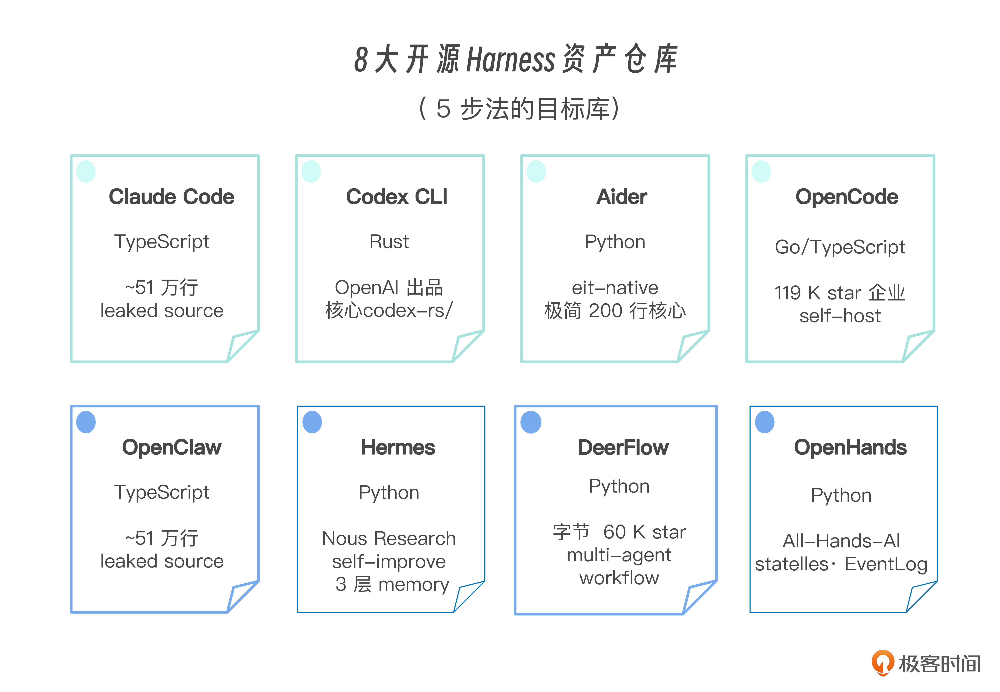
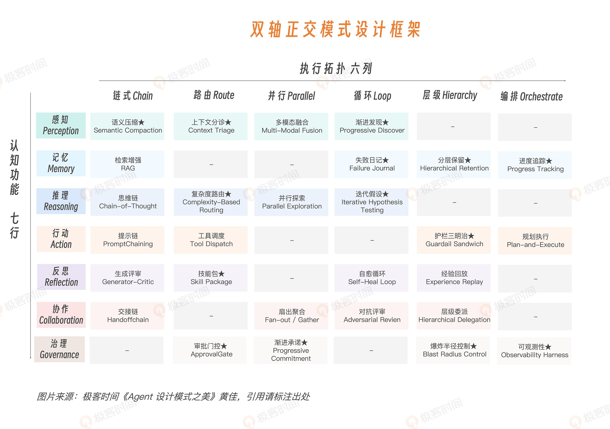
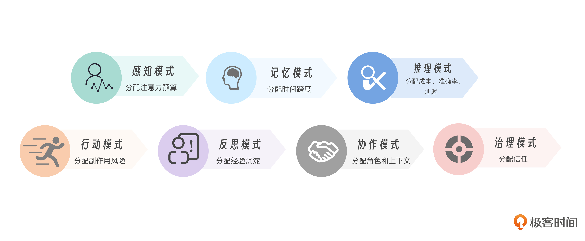
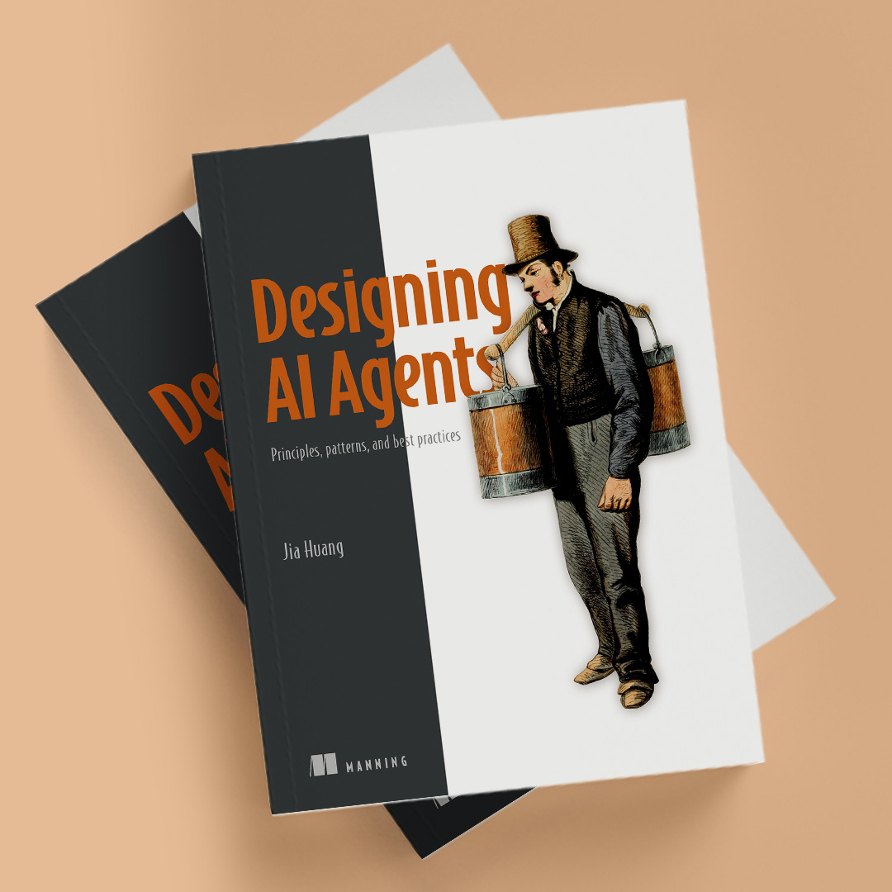
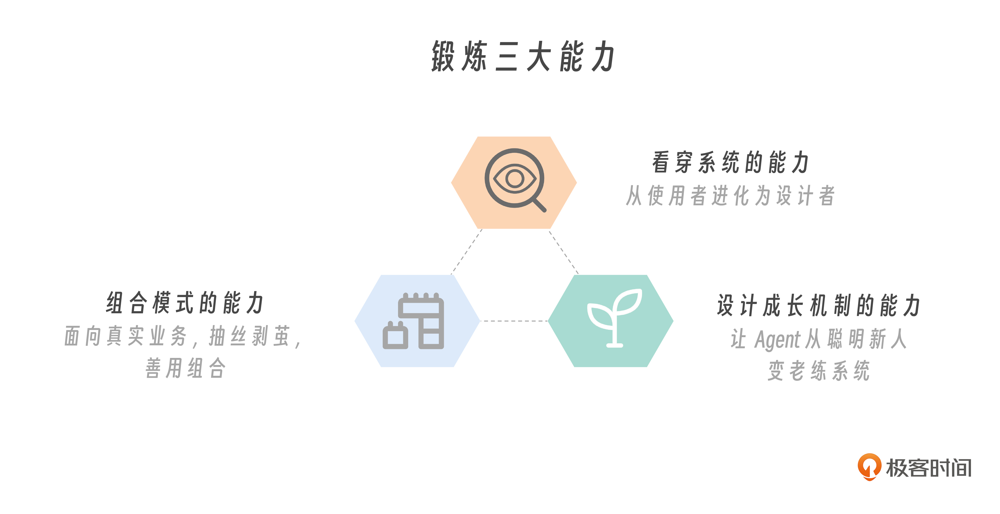

# 开篇词｜把一千个真实工程问题凝结成 28 个设计模式

> 课程：黄佳《Agent 设计模式之美》（极客时间专栏）
> 配套英文书：《Designing AI Agents》（Manning）
> 核心命题：**Agent 架构 = 不确定性下的有限资源分配（bounded resource allocation under uncertainty）**
> 原文链接：https://time.geekbang.org/column/article/980705
>
> 📝 相关笔记：[速览版](开篇词-速览版.md) · 🧠 [在浏览器中打开脑图](http://127.0.0.1:8765/notes/agent-design-patterns-beauty/%E5%BC%80%E7%AF%87%E8%AF%8D-%E8%84%91%E5%9B%BE.html) · 或双击本地文件 [开篇词-脑图.html](开篇词-脑图.html)

---

## 一、起点：一千个真实工程问题

2026 上半年作者回复了 1000+ 真实工程问题（《Claude Code 工程化实战》专栏 587 条留言 + 539 条回复、行动营、群聊、知识星球），看到的不是 demo 的成败，而是工程师真正卡住的地方：

- Claude Code 能写代码，为什么一进公司仓库就乱？
- SubAgent 开了 5 个，为什么答案更多、决策反而更差？
- CLAUDE.md 写了很多规则，为什么 Agent 还是会忘？
- MCP 工具都接上了，为什么工具越多越容易选错？
- 代码审计 Agent 发现了问题，为什么下次还踩同一个坑？
- 长任务跑两小时，为什么跑着跑着偏离目标、甚至越权？

**关键判断：团队缺的不是工具（Claude Code、Cursor、LangGraph、MCP……大家都能接，demo 都能跑），缺的是"设计语言"** —— 类比后端出问题不会只说"代码不够好"，而会追问事务边界、缓存、幂等、限流、索引。成熟工程领域要有自己的问题语言。

> 图：从真实工程问题与主流 Harness 架构（Claude Code、Codex、OpenCode、Aider、OpenClaw、Hermes、OpenHands、DeerFlow）中抽出公共结构。

## 二、核心观点

### 1. Agent 的价值 = 沉淀经验的能力，而非今天的聪明

Demo 漂亮不等于三个月后还有用。判断标准：

- 有没有记住踩过的坑？有没有把失败调用写进**失败日记**？
- 有没有把成功流程沉淀成 **Skill**？
- 处理过 100 个 PR 后，是否比第 1 个更懂这个仓库？

> 没有沉淀 → 它只是"每天重新入职的聪明新人"。目标是做**会成长、会沉淀、会被治理、会被复用、会变老练**的 Agent 系统。

### 2. 范式变化：不是工具升级

| 维度 | 传统软件 | Agent 系统 |
|---|---|---|
| 控制流 | 工程师设计时写死在代码里 | 一部分交给模型**运行时**决定 |
| 确定性 | 输入一样输出基本一样 | 动态生成，编译期无法写死 |
| 出错处理 | 异常栈、日志、重试、事务 | 需要新的设计语言 |

**金句：The model spends; the harness budgets.（模型负责花，Harness 负责预算）**

模型花的是上下文、token、工具调用机会、用户信任；Harness 决定怎么花、什么时候不能花、花错了怎么止损。

⚠️ 资源悖论：

- 200K token → 不一定更聪明，可能只是更乱
- 40 个工具 → 不一定更强，可能混乱迷失
- 8 个 SubAgent → 不一定更全面，可能是 8 份无法合并的噪声
- 完全自主权 → 不像专家，只是更快把错误扩散到外部

### 3. 第三代模式语言

| 代际 | 解决的问题 |
|---|---|
| 第一代：GoF 23 个设计模式 | 确定性对象之间的协作（对象复杂度） |
| 第二代：分布式系统模式 | 不可靠服务之间的协作（网络、状态、失败复杂度） |
| **第三代：Agent 设计模式** | **概率智能在工程系统里怎么可靠工作**（运行时决策、上下文注意力、工具副作用、经验累积、多 Agent 协作、治理边界） |

> 不是 GoF 过时了，而是它解决的是"确定性对象怎么协作"；Agent 设计模式解决的是"概率智能怎么可靠工作"。

## 三、双轴正交框架（贯穿全课程的核心坐标系）

> 图：贯穿整门课程的坐标系 —— 认知功能 × 执行拓扑，展开为四层结构：7 个认知功能、6 种执行拓扑、28 个工程模式、每个模式的源码剖析与工程实现。

### Y 轴 · 认知功能（Cognitive Function）—— WHAT，花什么资源（7 个）

| 功能 | 解决的问题 |
|---|---|
| 感知 | 看见世界（世界进来的**入口**） |
| 记忆 | 跨**时间**保存状态 |
| 推理 | 做判断、决策 |
| 行动 | 改变外部世界 |
| 反思 | 检查和改进自己（**审计**决策） |
| 协作 | 跨**空间**分工（任务分给多角色） |
| 治理 | 被信任地放进企业流程（动作出去前的**闸门**） |

> 这 7 个功能不是随便排的，它们形成完整的智能系统闭环：感知是入口、治理是闸门；记忆解决跨时间、协作解决跨空间；推理做决策、反思审计决策；行动是智能对现实世界的真实改变。

### X 轴 · 执行拓扑（Execution Topology）—— HOW，怎么花（6 种）

- **链式**：一步步走
- **并行**：多路同时看
- **路由**：从多条路里选
- **循环**：试了再改
- **层级**：主 Agent 拆给子 Agent
- **编排**：Agent 之间的统筹协调

**用法**：讨论 Agent 时先问"它在解决哪类认知问题？"，再问"这个能力该怎么编排？" → 28 个模式从孤立技巧变成**可定位、比较、组合、复盘的工程零件**。

## 四、28 个模式的本质：不是 28 个技巧

**都在回答同一个问题：不确定性下，有限的资源该怎么分配。**

| 模式 | 管理的稀缺资源 |
|---|---|
| 上下文分诊 Context Triage | 注意力分配（有限窗口里谁该进入） |
| 语义压缩 Semantic Compaction | 有损压缩（错误堆栈永远不能压） |
| 工具调度 Tool Dispatch | 工具分配、风险、状态刷新 |
| 生成-批评 Generator-Critic | 生成与评估的不对称性（找 bug 比写出无 bug 代码容易 → 用 critic 约束 generator） |
| 经验回放 Experience Replay | 把经验资产变成下次任务的上下文 |
| 审批门控 Approval Gate | 信任分级（什么自动做、什么必须人看） |

> 图：感知分配注意力，治理分配信任，中间几层各自分配时间、成本、风险、经验和角色。

> 底层判断（引自《Designing AI Agents》第一章）：Agent architecture is bounded resource allocation under uncertainty.
> 直白说：Agent 工程不是让模型自由发挥，而是让有限的注意力、记忆、工具、权限和信任资源，被花在最值得花的地方 —— 这就是 Harness 的意义。

## 五、课程结构（9 模块 · 44 篇）

| 模块 | 主题 | 代表模式 |
|---|---|---|
| 01 范式觉醒 | 认知地图：GoF 为何不够用、双轴框架、逆向五步法 | — |
| 02 感知 | 看到什么决定能想什么；token 花在刀刃上 | 上下文分诊、语义压缩、渐进发现、多模态融合 |
| 03 记忆 | 把短期上下文、长期记忆、失败经验、进度状态组织成记忆系统 | — |
| 04 推理 | 脑力分级，推理成本花在真正需要搜索的地方 | 思维链、复杂度路由、并行探索、迭代假设验证 |
| 05 行动 | 每次工具调用都带风险、权限、副作用 | 工具调度、规划执行、提示链、护栏三明治 |
| 06 反思 | 成长性看反思 | Generator-Critic、Skill Package、Experience Replay、Self-Heal Loop |
| 07 协作 | 多 Agent 本质 = 上下文隔离 + 角色分工 + 结果聚合 | 层级委派、扇出聚合、对抗评审、交接链 |
| 08 治理 | 越能干越需要治理 | 审批门、爆炸半径、渐进承诺、可观测性 Harness |
| 09 组合 | 装成一个完整系统 | 模式选型卡、六步选型法 |

**配套资源**：

- 代码仓库（模式案例）：https://github.com/huangjia2019/agent-design-patterns
- 代码仓库（从 0 到 1 构建 Coding Agent）：https://github.com/huangjia2019/designing-ai-agents
- ADPS 社区模式规范：https://adpsagent.com/zh/patterns/
- 《Designing AI Agents》（Manning，$20.99 折扣码 designing-ai，数字版）

## 六、学完应获得的三种能力

1. **看穿系统**：Agent 不稳定时，能追问是看错上下文、记忆断裂、推理档位不对、工具太多、缺反思、上下文污染，还是治理缺失 —— 从使用者变成设计者
2. **组合模式**：真实业务是混合问题。例：金融研报 Agent = 多模态融合（PDF/图表）+ RAG（历史报告）+ 复杂度路由（控成本）+ Generator-Critic（事实核查）+ 审批门控（防直接发给客户）+ 可观测性（引用链）—— 单个模式是零件，适配组合才是架构
3. **设计成长机制**：失败日记（Failure Journal）、技能包（Skill Package）、经验回放（Experience Replay）、进度追踪（Progress Tracking）、交接产物、可回放记录 → Agent 从第 1 天的聪明，长成第 365 天的老练

## 七、值得收藏的留言区补充（作者亲自回复）

- **Agent 产品架构**：`用户 → Agent Runtime → Skills → Tools → Data`；产品层面收敛为五大模块：**感知、推理、执行、治理、记忆**（比争论 LangGraph/CrewAI/MCP 更接近产品架构本质）
- **组织演化三阶段**：
  - Stage 1（现在）：AI 作为个人加速器（信息孤岛，个人效率提升但整体不变）
  - Stage 2（先进团队）：共享 AI context + 治理（团队 CLAUDE.md、shared Skills、AI 平台团队；个人 ×3-5，团队 ×2-3）
  - Stage 3（5-10 年）：AI 原生组织（人 + agent 混合编制，2-3 人 + 5-10 agent 按任务领域组队）
- **为什么"找 bug 比写无 bug 代码容易"**：Agent 自以为是，写出完美代码不可能，所以 debug 反而更容易且更重要，工程上要**主动给 debug 加结构**（Reflection / Memory / Governance 基础设施）。会写代码的追求一次写对，会做工程的追求出问题能快速定位
- **RAG 过时了吗**：没有。"RAG 已过时"只是特定场景下搜索比向量库更合适；Agent 不可能完全脱离 RAG，尤其是有企业知识库时
- **角色转化**：架构师 → 设计 agent 协作架构；高级工程师 → 产出 spec + 守质量门；中级工程师 → 编排调试验证 agent（最快被替代也最快跃迁）；初级工程师的成长曲线是行业未解难题

## 八、一句话总结

> **软件工程的稳定主题：把偶然成功，变成可重复成功。** Agent 工程也一样 —— 今天很多 Agent 成功是"刚好成功"（模型刚好看到对的信息、刚好选对工具、刚好没跑偏）。工程师要做的是找出"刚好"背后的结构：命名它、约束它、复用它、组合它，让下一次还成功、让别的团队也能成功、让半年后的 Agent 比今天更有经验。

编辑总结的对联，可作为全课纲领：

> **记失败、存经验，价值始聚**
> **知进退、懂组合，系统方生**

---

*笔记生成时间：2026-10-14 · 图片版权归属极客邦科技/黄佳，仅作个人学习收藏*
