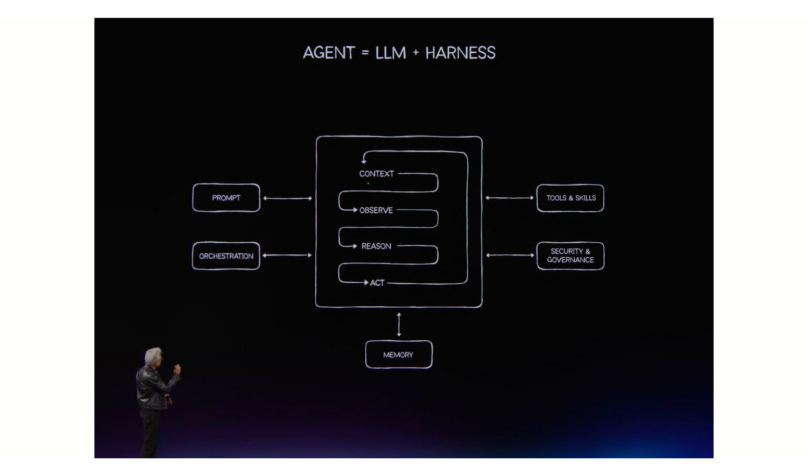
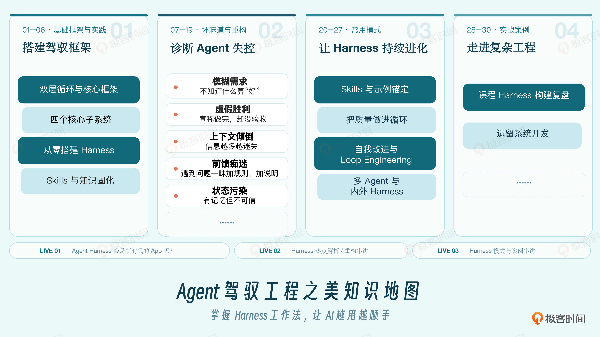

# 开篇词｜驾驭工程：Agent 时代必修课

> 《Agent 驾驭工程之美》· 徐昊 · 核心命题：模型不再稀缺，稀缺的是能高效利用大模型的人；驾驭工程（构建 Harness 的能力）就是 Agent 时代的必修课
> 📝 相关笔记：[速览版](开篇词-速览版.md) · 🧠 [在浏览器中打开脑图](http://127.0.0.1:8765/notes/agent-harness-engineering-beauty/%E5%BC%80%E7%AF%87%E8%AF%8D-%E8%84%91%E5%9B%BE.html) · 或双击本地文件 [开篇词-脑图.html](开篇词-脑图.html)
> 🔗 原文：https://time.geekbang.org/column/article/1007731（2026-08-18 发布）


*开篇词头图：Agent 时代，驾驭工程是每个人的必修课*

## 一、引子：操作系统 + Agent，取代操作系统 + App

> 多年以后，当你仅靠操作系统内置的 Agent，无需任何应用（App）便点好晚饭时，你将会回想起英伟达的黄仁勋为你介绍 Harness 的那个下午。

2026 年 6 月 1 日台北，黄仁勋向全世界宣布：**个人电脑的操作系统将经历一次根本性改变——存在了三十多年的「操作系统 + App」架构，将被「操作系统 + Agent」的全新结构取代。**

这意味着：
- 不再需要为每个功能安装一个专门的 App
- 想点外卖：不需要打开外卖软件、不需要注册账号、不需要学习界面，只要告诉操作系统内置的 Agent 你想吃什么，它就会调用必要的工具帮你下单
- 交互范式变化：**过去我们打开应用、点击输入；现在我们用自然语言告诉 Agent 我们的意图，Agent 生成代码或调用工具来产生结果**


*黄仁勋宣布「操作系统 + Agent」新架构：LLM 是大脑，Harness 是身体*

在新模式中，**Agent 是一切的核心**，由四部分组成：

| 组成 | 黄仁勋的比喻 | 职责 |
|---|---|---|
| 大语言模型（LLM） | 大脑 | 负责思考 |
| **Harness** | **身体** | **连接一切：协调信息路由、管理记忆、调用工具** |
| 工具（Tools） | — | 被 Agent 调用执行具体操作 |
| 运行时（Runtime） | — | 承载运行的底层环境 |

> 没有 Harness，大模型只是一颗会思考的头颅，无法真正行动。

## 二、Harness 真的有用吗？—— 马具的比喻

Harness 本意是**马具**：缰绳、马鞍、马镫、笼头，这些东西加起来叫 Harness。

> 一匹马哪怕是**的卢赤兔**，它也不会知道你要去哪、该加速还是减速、在哪停下来。你得给它装上马具，得学会怎么用缰绳控制它。
> **大语言模型就是这匹马。它越来越能跑，但它永远不知道你的意图、你的边界、你的标准。这些要靠你来告诉它，靠你来检查它，靠你来调整它。这就是 Harness。**

### 周报的例子：裸跑大模型 vs 构造 Harness

**方式一：直接用大模型**——「帮我写周报，这是我这周做的事：上线了用户反馈功能、跟销售团队开了两次会讨论需求优先级、修复了 3 个 bug。」

结果：模型洋洋洒洒回复一篇，但上周还是流畅的文字，这周变成干巴巴的列表，风格完全不同；它完全不知道上周做了什么，每个项目都像从零开始。来回折腾半小时，最后还是自己动手。

**方式二：构造 Harness**——创建目录，编写一个 AGENTS.md：

```markdown
## 周报编写

### 项目结构
reports/ ← 存放所有历史周报，按周归档
 ├── 2026-W01.md ← 第 1 周周报
 ├── 2026-W02.md ← 第 2 周周报
 └── ...

### 工作流程
1. 用户提供本周的工作要点
2. **阅读 reports/ 目录下最近 8 周的周报**，了解进展和风格
3. 按规定的结构生成周报
4. **自动检查**：是否有至少 2 个亮点？亮点是否有数据？阻塞项是否有责任人？
5. 以 Markdown 表格输出并存入 reports/ 目录，按周命名
6. 如果没有之前的周报，则需要用户给出大致的项目背景和说明

### 结构
1. 本周亮点（列出 2-3 个具体的成果，每个附带数据）
2. 完成事项（列表，每行一个事项）
3. 阻塞项（如有，注明责任人和原因）
4. 下周计划（列表）

### 风格要求
使用客观陈述语气，避免「扎实推进」「锐意进取」等套话
每个亮点必须有具体结果：什么、效果、数据
```

然后通过 OpenClaw、Claude 或 Hermes 这样的 Agent，将工作目录设置到这个目录，与 Agent 互动——**连续写几周周报的话，连贯性和一致性都会变得很好。**

### Harness 的四个基本手段

> 我们把一次性的提示词改成了**可重复的 AI 项目**。

| 手段 | 英文 | 周报例子中的体现 |
|---|---|---|
| 项目仓库 | Repository | 工作内容不仅存在于大模型中，也存在于文件系统中 |
| 前馈 | Feedforward / Guides | 周报的结构和风格要求 |
| 反馈 | Feedback / Sensors | 对周报结果的检查：几个亮点、有没有数据、阻塞项有没有责任人 |
| 状态管理 | State | 通过文件自动留存过往信息和上下文，在不同周报之间保持一致 |

通过这样的描述，我们就能在重复的任务中**驾驭** AI 生成周报的质量。

### Anthropic 的对照实验（2025）

同一个模型、同一个任务、同一个提示词：「做一个 2D 复古游戏编辑器」。

| | 第一轮：裸跑 | 第二轮：配多 Agent Harness |
|---|---|---|
| 配置 | 模型直接上 | 一个负责规划，一个负责生成，一个负责验收 |
| 耗时 | 20 分钟 | 6 小时 |
| 结果 | 模型认为做完了，**核心功能完全不能用** | **功能完全可用** |

> 他们没有换模型，没有修改提示词。**唯一改变的是为模型添加了 Harness。**（当然，词元 token 成本也多花了不少。）

> 在无数个实际应用中，我们反复发现：**再好的模型，对于复杂任务裸跑依然失败。Harness 不是过渡期的权宜之计，它是伴随 AI 长期存在的基础设施。** 当然，现在我们知道，它除了是基础设施，更是**模型的操作系统**。

## 三、为什么所有人都要学驾驭工程？

**驾驭工程 = 构建 Harness 的能力 = 驾驭 Agent 的能力。**

最明显的理由是 AI PC（2026 年 12 月底才真正推出，还需要时间普及），但它展示了一种趋势：

> **模型不再稀缺，真正稀缺的是能高效利用大模型的人。** 今天我们需要付费才用到大模型，未来直接运行在台式机、笔记本电脑甚至手机上。相当于人手一台法拉利，那么问题就变成：**你能开到多快？**

### 反直觉：AI 不是让差距变小，而是变大？

「AI 不是要赋能每一个人吗？有了 AI，大家效率差距不是会变小吗？」

| | 一次性任务 | 重复性工作 |
|---|---|---|
| 例子 | 写邮件、润色文字、生成图片 | 周报每周写、汇报每月做、新项目搭环境 |
| 提示词打磨性价比 | 只用一次，花大力气打磨性价比不高 | **收益每次执行都在累加** |
| AI 效果 | 的确缩小差距 | **使用 AI 的效率差异很明显** |

> 重复性工作的价值是累积的。为重复性工作搭好的 Harness，收益是每次执行都在累加。

### 一人团队（One Person Team，OPT）

这种累积效应催生了新的工作形态：**一个人借助 AI 完成过去一整个团队的工作——搭好 Harness，Agent 负责执行，人负责检查和调整。**

两个真实案例：

| 案例 | 数据 |
|---|---|
| 某团队 90 天从 Pod 到 OPT | 8 人（前端/后端/基础设施/QA/产品/设计）→ 3 人；QA 被自动化套件替代，产品经理和设计师多团队共享；每人覆盖过去 2-3 个角色；公司认定「3 个善于驾驭 AI 的工程师 = 之前 6 个工程师」 |
| Meta 研发团队重组 | 围绕 Agent 重组后，员工与管理者的比例达到 **50:1**（过去十年的标准是 8:1） |

越来越多创业公司采用 OPT 模式，尝鲜企业也在积极推进。

> 驾驭工程除了让我们更有效地操作 AI PC，很大的几率将会是我们**未来的主要工作模式**。

### 对程序员的特殊意义

> 随着特定应用程序的消失，**为 Agent 构造工具以及构造 Harness 系统，可能是为数不多的、留给程序员的工作了。**

## 四、如何学习驾驭工程？

> 驾驭工程不是写提示词的技巧，也不是编程能力，而是**一种思维模式和工作习惯**。

具体来说：当 AI 产出不满意时，不再说「模型不行」或「再改改 Prompt 试试」。**停下一秒，问自己三个问题：**

1. 问题出在哪一环节？
2. 是没提前说清楚（**前馈不够**）？
3. 是没检查对（**反馈不够**）？还是前一轮的结果没有被记住（**状态丢了**）？

然后动手改的，**不是 Prompt，而是对应的那个环节的 Harness**。

**非程序员的隐形门槛**：程序员的职业习惯——设计项目目录结构、版本控制、写测试——这些都是驾驭工程的基础。非技术人员往往缺少这些习惯，用 AI 更像是在碰运气。越早学会驾驭工程，就越早从「碰运气」切换到「有方法」。

## 五、课程结构：四个部分


*课程四大板块：基础框架与实践 → 坏味道与重构 → 常用模式 → 综合实战*

| 部分 | 主题 | 内容 | 学完收获 |
|---|---|---|---|
| 第一部分 | 基础框架与实践 | 双层操控循环 + 四个子系统；通过背单词 Harness 完成第一个可运行、可复用的 AI 工作系统 | 把一次对话沉淀成文件、规则和技能，让有效经验不随对话结束而消失，内化为 Agent 的行事原则 |
| 第二部分 | 坏味道与重构手法 | 13 类常见问题：需求模糊、约定只在人脑子里、Agent 假装完成、指令文件腐化、上下文倾倒、状态污染、环境缺失等 | Agent 输出不稳定时，不再吐槽「模型不行」，能定位哪一环出问题并针对性重构 |
| 第三部分 | 常用模式 | Skills、示例锚定、内部质量、自我改进、控制循环、多 Agent 编排；比较外部 Harness 与内部 Harness | 逐渐形成自己的模式库，高效驾驭大模型 |
| 第四部分 | 综合实战 | 两个经典案例复盘：知识工程构建 + 遗留系统开发 | 看 Harness 如何从需求、知识、工具和验证逐步建立，掌握让 Harness 持续演化、产生复利的思路 |

> 这门课最终要教给你的，不是某个工具的操作方法，而是**把意图、知识、检查标准和工作状态组织成一套可重复运行的系统**。无论你是不是程序员，这都是与 Agent 长期协作时最重要的能力。

## 留言区说明

本讲为开篇词，无思考题。留言区共 15 条留言，置顶留言为课程交流群入口（http://gk.link/a/12LoG），暂无需要提炼的高价值技术讨论。

## 一句话总结

> 模型是马，Harness 是马具；驾驭工程不是让马跑得更快，而是让你能骑上它、指哪去哪——**把意图、知识、检查标准和工作状态组织成一套可重复运行的系统，就是 Agent 时代每个人的必修课。**

---
*笔记生成时间：2026-10-14 · 图片版权归属原出处，仅作个人学习收藏*
